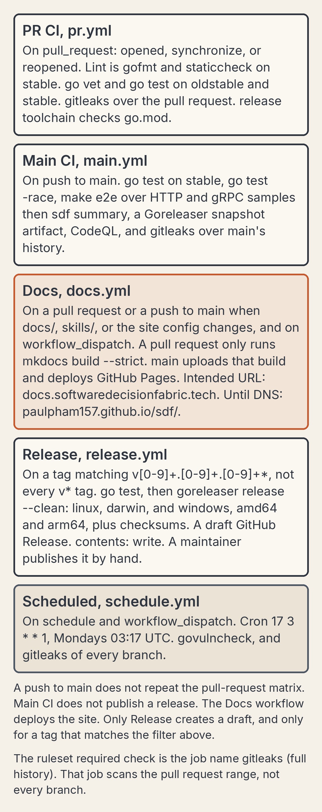

# Contributing

Pull request checks and the post-merge checks are different workflows. A push
to `main` does not repeat the pull request matrix. Main CI does not deploy or
publish a release. The Docs workflow deploys the documentation site when `docs/`
or the site config changes on `main`. Only the Release workflow creates a
release, as a draft, when a version tag matching `v[0-9]+.[0-9]+.[0-9]+*`
(for example `v0.1.0` or `v0.1.0-rc.1`, not `v1`) is pushed. Publishing a
stable release (not a draft or prerelease, and a tag that is exactly
`vMAJOR.MINOR.PATCH`) opens a pull request that updates `CITATION.cff`. The
Citation workflow dispatches the gitleaks scan, posts the required commit
status, and merges the pull request. Cite this repository reads the default
branch, so it stays stale until that pull request merges.

| Workflow | When | Why |
| --- | --- | --- |
| PR CI (`.github/workflows/pr.yml`) | `pull_request` opened, new commits (`synchronize`), or reopened | Fast feedback before merge: `gofmt` and staticcheck on the stable Go toolchain, `go vet` and `go test` on oldstable and stable, a `release toolchain (go.mod)` job that checks the `toolchain` line against the Go binary goreleaser would use, and a gitleaks scan of the commits in the pull request. |
| Main CI (`.github/workflows/main.yml`) | `push` to `main` | Fuller check of the merged tree: one stable `go test` (a squash of a stale branch can fail even when each side passed), `go test -race`, build `sdf` with `CGO_ENABLED=0` and run `tests/samples` through `sdf serve` over HTTP and gRPC then `sdf summary`, a Goreleaser snapshot uploaded as a workflow artifact, CodeQL, and gitleaks over main's history. |
| Release (`.github/workflows/release.yml`) | `push` of a tag matching `v[0-9]+.[0-9]+.[0-9]+*`, nothing else | `go test`, then `goreleaser release --clean`: archives for linux, darwin, and windows on amd64 and arm64 plus `checksums.txt`, uploaded to a draft GitHub Release that a maintainer publishes by hand. This job has `contents: write` to upload the draft. |
| Citation (`.github/workflows/citation.yml`, `.github/workflows/citation-gitleaks.yml`) | a GitHub Release is published, and it is not a draft or prerelease | Opens `citation/vMAJOR.MINOR.PATCH` from the default branch and a pull request that sets `version` (no leading `v`), `date-released` (the UTC calendar date of `published_at`), and the release tag's peeled commit in `CITATION.cff`. Skips drafts, prereleases, tags that are not `vMAJOR.MINOR.PATCH`, a file that already matches, and a release older than the version already in the file. The release tag is not moved. A `GITHUB_TOKEN` pull request does not start PR CI, so the Citation job dispatches `citation-gitleaks.yml` on that branch. The scan is the same base..head gitleaks range as PR CI. GitHub does not count a `workflow_dispatch` job check toward a ruleset, so after the run succeeds the job posts a commit status named `gitleaks (full history)` on the head SHA and merges that pull request with a merge commit. Cite this repository stays stale until that merge; confirm the pull request merged before sending people to Cite. `contents: write`, `pull-requests: write`, `actions: write`, and `statuses: write` are limited to that job. The token is not left in git config. |
| Scheduled (`.github/workflows/schedule.yml`) | Mondays 03:17 UTC | Depends on time, not on a new commit: `govulncheck` (new advisories) and a gitleaks scan of every branch. |
| Docs (`.github/workflows/docs.yml`) | `pull_request` or `push` to `main` when `docs/`, `skills/`, or the site config changes; also `workflow_dispatch` | On a pull request, `mkdocs build --strict` only. On `main`, that same build is uploaded and deployed to GitHub Pages. The intended URL is `https://docs.softwaredecisionfabric.tech/` after the one-time setup below. Until then the site is at `https://paulpham157.github.io/sdf/`. |

[](docs/diagrams/09-ci-workflows.png)

Source: [09-ci-workflows.tldr](docs/diagrams/09-ci-workflows.tldr) (open in [tldraw](https://www.tldraw.com); the official file extension is `.tldr`).

The branch ruleset requires the check name `gitleaks (full history)`. On a
human pull request that check is the PR CI job. The name is the ruleset
context. The scan is the pull request's commit range, not every branch. The
ruleset requires that check before the default branch updates, and GitHub
Actions cannot bypass it. The ruleset does not pin that check to the GitHub
Actions app, so a commit status with that context satisfies it. Any token
with `statuses: write` can post that status. The Citation workflow posts it
on the citation head SHA after its dispatched scan succeeds, then merges.
That merge is how `CITATION.cff` lands on the default branch.

This workflow cannot change the ruleset. Pin the required check
`gitleaks (full history)` to the GitHub Actions app, or turn this auto-merge
off.

Run the pull request checks locally:

```bash
make fmt-check
make staticcheck
make vet
make test
```

`make staticcheck` compiles staticcheck 2026.2.2 (`honnef.co/go/tools`
v0.8.2). CI installs that same release as a checksum-verified binary.
`make fmt-check` uses whatever `gofmt` is on `PATH`; CI uses the stable
toolchain.

The post-merge checks:

```bash
make race
make e2e
```

`make e2e` builds the static binary and runs `tests/e2e` (`go test -tags e2e`).
Plain `go test ./...` does not build that package.

## Documentation site

The Markdown under `docs/` is built with [MkDocs](https://www.mkdocs.org/)
and the [Material](https://squidfunk.github.io/mkdocs-material/) theme.
Pages render the existing files with no rewrite of their body text.
Mermaid fences and search are enabled. Each page has a View on GitHub
link to that page's source file. The header has a Website link to the
product site, on desktop and on a phone. The theme follows
`design/tokens.css` (see `docs/design/tokens.md`), including a dark scheme
the reader can select. The app UI stays light.
Skill files under `skills/` are included at build time so the relative
links already in the docs keep working.

Build or preview locally:

```bash
python3 -m venv .venv-docs
.venv-docs/bin/pip install -r requirements-docs.txt
make docs          # mkdocs build --strict
make docs-serve    # http://127.0.0.1:8000/
```

`--strict` fails the build on a broken internal link or missing anchor.
`.venv-docs/` and the generated `site/` directory are gitignored.

### One-time GitHub Pages setup

Do this **before** merging a change that deploys the docs site to
`main`. The workflow does not enable Pages, create DNS records, or
change repository settings. If Pages is not enabled first, the deploy
job on the merge commit will fail; after you enable it, re-run the
Docs workflow on `main` (`workflow_dispatch`).

1. In the repository on GitHub: **Settings → Pages → Build and
   deployment → Source**, choose **GitHub Actions**.
2. After Pages is enabled, merge the docs-site change (or any later
   change that triggers the Docs workflow) to `main`, or run the
   **Docs** workflow from the Actions tab (`workflow_dispatch`) on
   `main`. Until a custom domain is attached in the Pages settings,
   the site is at `https://paulpham157.github.io/sdf/`.
3. Custom domain (optional, intended production URL):
   - Create a DNS `CNAME` record for `docs.softwaredecisionfabric.tech`
     pointing at `paulpham157.github.io`.
   - In **Settings → Pages → Custom domain**, enter
     `docs.softwaredecisionfabric.tech` and wait for the TLS
     certificate. Turn on **Enforce HTTPS** once it is ready.
   - Do not add a `CNAME` file to the built site. Setting the domain
     only in the Pages settings keeps
     `https://paulpham157.github.io/sdf/` working as a fallback.
4. If the GitHub `github-pages` environment is created with required
   reviewers, a maintainer has to approve the first deploy.

No extra token or Actions secret is required. The deploy job uses the
default `GITHUB_TOKEN` with `pages: write` and `id-token: write`.

