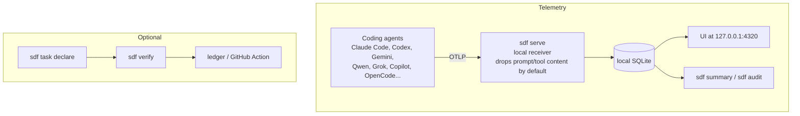
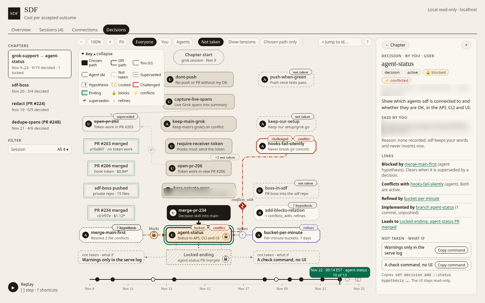

# SDF

SDF is a local OpenTelemetry collector for people who use coding agents. It
records tokens, cost, tool use, and sessions on your machine, and summarizes
them. It does not launch, route, or sandbox the agents; it only listens.





## Install

With Go 1.26 or newer:

```bash
go install github.com/paulpham157/sdf/cmd/sdf@latest
sdf version
```

That puts `sdf` in `$(go env GOPATH)/bin` (usually `~/go/bin`); keep that
directory on your `PATH`. If `sdf version` says `command not found`, run
`export PATH="$(go env GOPATH)/bin:$PATH"` and add that line to your shell
profile. Until the first tagged release, `@latest` is the
newest commit on `main`. There is no release yet; prebuilt archives for
Linux, macOS, and Windows (amd64 and arm64) will be on
[GitHub Releases](https://github.com/paulpham157/sdf/releases) after one is
published.

Or build from source (no C compiler needed):

```bash
git clone https://github.com/paulpham157/sdf && cd sdf && make build
```

## Quickstart

You need a supported coding agent already installed. The receiver itself
needs no API key or network connection.

1. Start the receiver and leave it running:

   ```bash
   sdf serve
   ```

   It listens for OTLP/HTTP on `127.0.0.1:4318` and OTLP/gRPC on
   `127.0.0.1:4317`, writes `sdf-telemetry.sqlite` in the current directory,
   and serves the UI at <http://127.0.0.1:4320/>.

2. Point an agent at it:

   ```bash
   sdf init claude-code --write   # or codex, opencode, pi, qwen, grok, gemini, copilot
   sdf init --check
   ```

   Without `--write`, `sdf init` only prints the exporter settings.

3. Restart the agent so it reads the new settings, and use it as usual.

4. Open <http://127.0.0.1:4320/>, or run `sdf summary`.

## Commands

| Command | What it does |
| --- | --- |
| `sdf serve` | Receive OTLP, store it in local SQLite, and serve the UI |
| `sdf init` | Print or write the settings that point an agent at the receiver |
| `sdf summary` | Print sessions: duration, tokens, tool calls, and cost |
| `sdf decision` | Record, link, list, or retract decisions (`add`, `link`, `list`, `retract`) |
| `sdf audit` | Verify or print the head of the optional hash-chained ledger (`verify`, `head`) |
| `sdf task` | Declare or show a task's acceptance criteria (`declare`, `show`) |
| `sdf verify` | Run a declared task's checks against a commit |
| `sdf redact` | Drop stored prompt, response, tool, and error text from a database |
| `sdf check` | Run the embedded local cases against the summary |
| `sdf prices refresh` | Update the bundled OpenRouter price table (the only command that uses the network for prices) |
| `sdf version` | Print version, commit, build date, Go version, and platform (`sdf --version` and `sdf -v` are the same) |

Every command prints its flags with `--help`. Authentication is off by
default; keep the binds on localhost. Optional flags (UI, token, prices,
git repo, budget, ledger) are in the docs below.

## Supported agents

The tools do not emit the same signals. A field the summary cannot find is
reported as not present. SDF does not estimate tokens or duration. It does
compute a cost from the token counts it already derived and a price table
copied from OpenRouter. That figure is separate from the cost the agent
reported. A model with no published price is `unknown`, not zero.

| Agent | Notes |
| --- | --- |
| Claude Code | Traces, logs, and metrics. Off until `CLAUDE_CODE_ENABLE_TELEMETRY=1`. |
| Codex CLI | Own `otel.*` config; does not read `OTEL_*`. |
| Qwen Code (`@qwen-code/qwen-code`) | Traces, logs, and metrics; gRPC on 4317 by default. `sdf init qwen` sets `logPrompts: false`. |
| Grok CLI (`grok`) | External logs and metrics; internal traces when pointed here. |
| Gemini CLI (`@google/gemini-cli`) | Traces, logs, and metrics. Off until `telemetry.enabled`. |
| GitHub Copilot CLI (`@github/copilot`) | Traces and metrics, no log signal. On when the OTLP endpoint is set. |
| OpenCode v2 (`@opencode/cli`) | Traces. No per-session logs or metrics. npm `opencode-ai` is v1, not this CLI. |
| Pi (`@earendil-works/pi-coding-agent`) | Not built in; uses the community `pi-otel` extension. |

What each tool exports, and how to point it at the receiver, is in
[docs/agents.md](docs/agents.md).

## Privacy

Everything stays on your machine. Before storing, `sdf serve` drops prompt,
response, tool, and error text from every agent, whatever the agent's own
settings say. Names, ids, tokens, cost, durations, and success stay, so
summaries still work.

To keep the text, start the receiver with `sdf serve --store-content` (or
`SDF_STORE_CONTENT=1`, or a list of agents such as
`--store-content=qwen,claude-code`). A database written by an older sdf
keeps its rows until you run `sdf redact --db PATH`. See
[Content storage](docs/receiver.md#content-storage).

## Docs

| Document | What it covers |
| --- | --- |
| [docs/agents.md](docs/agents.md) | What each tool exports, and the settings that point it at the receiver |
| [docs/receiver.md](docs/receiver.md) | The receiver, content storage, the UI, `sdf init`, and the git hooks |
| [docs/summary.md](docs/summary.md) | How a session is summarized, and how cost is computed |
| [docs/outcomes.md](docs/outcomes.md) | Linking a session to a commit or pull request, decision records, and the local budget |
| [skills/README.md](skills/README.md) | The `sdf-decisions` agent skill: record user and agent choices with `sdf decision` |
| [docs/check.md](docs/check.md) | `sdf check` and its cases |
| [docs/ledger.md](docs/ledger.md) | The hash-chained ledger, its encoding, `sdf audit verify` and `sdf audit head`, and what it does not protect against |
| [docs/tasks.md](docs/tasks.md) | `sdf task declare` and `sdf task show`: a task's acceptance criteria, hashed before an agent runs |
| [docs/verify.md](docs/verify.md) | `sdf verify`: run a declared task's checks against a commit, with evidence and a verdict |
| [docs/action.md](docs/action.md) | The `sdf verify` GitHub Action, and its threat model |
| [docs/gaps.md](docs/gaps.md) | Known limits of the collector and the summary |
| [CONTRIBUTING.md](CONTRIBUTING.md) | Tests and continuous integration |

Repository history from before this collector is preserved at the git tag
`legacy-v1` (commit `38f45e80ed05fd72e9387c2327d7fd7286bcfac3`).
