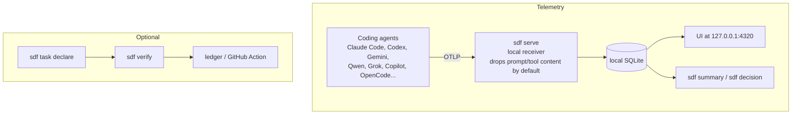

# SDF

[](https://github.com/paulpham157/sdf/actions/workflows/pr.yml)
[](go.mod)
[](LICENSE)

A local OpenTelemetry collector and decision ledger for coding agents.

SDF records tokens, cost, tool use, sessions, and decisions on your
machine, and summarizes them. It does not launch, route, or sandbox the
agents; it only listens. The receiver needs no API key or network
connection.


## Features

- A local OTLP receiver (HTTP on `127.0.0.1:4318`, gRPC on
  `127.0.0.1:4317`) that stores traces, metrics, and logs in SQLite, plus
  a read-only UI at <http://127.0.0.1:4320/>, with overview charts for
  decision-link recall, unlinked commits and decisions, and cost or
  sessions by day
- Session summaries: duration, tokens, tool calls, and a computed cost
  (separate from any cost the agent reported). SDF does not estimate
  tokens or duration. A model with no published price is `unknown`, not
  zero
- Decision records you write down (`sdf decision add`, `link`, `list`,
  `graph`, `brief`, `retract`, `audit`, `check`): who decided, alternatives,
  links to sessions and commits, and a read-only graph in the UI
- Prompt, response, tool, and error text is dropped before storing, for
  every agent, unless you opt in with `--store-content`
- Optional git hooks, commit and pull-request outcomes, and a local
  spend budget
- Optional hash-chained ledger, `sdf task declare` / `sdf verify`, and a
  fork-safe GitHub Action

## Quickstart

You need a supported coding agent already installed, and Go 1.26 or
newer.

```bash
go install github.com/paulpham157/sdf/cmd/sdf@latest
sdf serve
```

It listens for OTLP/HTTP on `127.0.0.1:4318` and OTLP/gRPC on
`127.0.0.1:4317`, writes `sdf-telemetry.sqlite` in the current directory,
and serves the UI at <http://127.0.0.1:4320/>. Leave it running. In
another terminal:

```bash
sdf init claude-code --write   # or codex, opencode, pi, qwen, grok, gemini, copilot
sdf init --check
```

Restart the agent so it reads the new settings, use it as usual, then
open <http://127.0.0.1:4320/> or run `sdf summary`.

`go install` puts `sdf` in `$(go env GOPATH)/bin` (usually `~/go/bin`);
keep that directory on your `PATH`. If `sdf version` says `command not
found`, run `export PATH="$(go env GOPATH)/bin:$PATH"` and add that line
to your shell profile. `@latest` installs `v0.1.0`. You can also pin it
with `go install github.com/paulpham157/sdf/cmd/sdf@v0.1.0`. Prebuilt
archives for Linux, macOS, and Windows (amd64 and arm64) are on
[GitHub Releases](https://github.com/paulpham157/sdf/releases/tag/v0.1.0).

Or build from source (no C compiler needed):

```bash
git clone https://github.com/paulpham157/sdf && cd sdf && make build
```

Without `--write`, `sdf init` only prints the exporter settings.

## Supported agents

The tools do not emit the same signals. A field the summary cannot find
is reported as not present. Computed cost comes from the token counts
the summary already derived and a price table copied from OpenRouter.

| Agent | Notes |
| --- | --- |
| Claude Code | Traces, logs, and metrics. Off until `CLAUDE_CODE_ENABLE_TELEMETRY=1`. |
| Codex CLI | Own `otel.*` config; does not read `OTEL_*`. |
| Qwen Code (`@qwen-code/qwen-code`) | Traces, logs, and metrics; gRPC on 4317 by default. `sdf init qwen` sets `logPrompts: false`. |
| Grok CLI (`grok`) | External logs and metrics; internal traces when pointed here. |
| Gemini CLI (`@google/gemini-cli`) | Traces, logs, and metrics. Off until `telemetry.enabled`. |
| GitHub Copilot CLI (`@github/copilot`) | Traces and metrics, no log signal. On when the OTLP endpoint is set. |
| OpenCode v2 (`@opencode/cli`) | Traces. No per-session logs or metrics. npm `opencode-ai` is v1, not this CLI. |
| Pi (`@earendil-works/pi-coding-agent`) | Not built in; uses the community `pi-otel` extension. |

What each tool exports, and how to point it at the receiver, is in
[docs/agents.md](docs/agents.md).

## Usage

Every command prints its flags with `--help` (or `sdf help <command>`).

| Command | What it does |
| --- | --- |
| `sdf serve` | Receive OTLP, store it in local SQLite, and serve the UI |
| `sdf init` | Print or write the settings that point an agent at the receiver |
| `sdf summary` | Print sessions: duration, tokens, tool calls, and cost |
| `sdf decision` | Record, link, list, graph, retract, audit, brief, or check decisions (`add`, `link`, `list`, `graph`, `retract`, `audit`, `brief`, `check`) |
| `sdf audit` | Verify or print the head of the optional hash-chained ledger (`verify`, `head`) |
| `sdf task` | Declare or show a task's acceptance criteria (`declare`, `show`) |
| `sdf verify` | Run a declared task's checks against a commit |
| `sdf redact` | Drop stored prompt, response, tool, and error text from a database |
| `sdf check` | Run the embedded local cases against the summary |
| `sdf prices refresh` | Fetch the OpenRouter catalog into the local price cache (the only command that uses the network for prices) |
| `sdf version` | Print version, commit, build date, Go version, and platform (`sdf --version` and `sdf -v` are the same) |

`sdf decision` relations include `supersedes`, `refines`, `blocks`,
`conflicts_with`, `constrains`, `implements`, `validates`, and
`contradicts`. `list` and the UI show blocked and conflicted records;
`graph` (also `GET /api/decisions/graph` and the UI's Decisions tab)
shows chapters, endings, and explored %; `brief` prints a ranked,
size-capped list of active constraints, blocked, and conflicting
decisions; `audit` reports unlinked decisions and commits (exit 1 on
findings); `check` exits 1 when an in-force decision forbids `push`,
`merge`, `release`, `deploy`, or an architecture change. `sdf init
--write` for Claude Code and Codex also installs a SessionStart hook
that runs `sdf decision brief` (no flags, 2s timeout, fail-open); other
agents run the command or use the `sdf-decisions` skill
([Decisions at session start](docs/agents.md#decisions-at-session-start)).
The `pre-push` git hook from `sdf init --git-hooks --db PATH` warns
about pushed commits that implement no decision
([pre-push decision check](docs/receiver.md#pre-push-decision-check)).
Details are in [docs/outcomes.md](docs/outcomes.md).

Authentication is off by default; keep the binds on localhost.

## Configuration

`sdf serve` writes `sdf-telemetry.sqlite` in the current directory
(`--db PATH` to change it). The same path is the default for
`sdf summary`, `sdf decision`, and `sdf redact`.

| Flag or variable | What it does |
| --- | --- |
| `--host`, `--port`, `--grpc-port` | OTLP bind (defaults `127.0.0.1`, `4318`, `4317`). `--host` does not move the UI |
| `--ui-addr`, `--no-ui` | UI listen address (default `127.0.0.1:4320`), or disable the UI |
| `--store-content` / `SDF_STORE_CONTENT` | Keep prompt, response, tool, and error text (`1` for every agent, or a list such as `qwen,claude-code`) |
| `--otlp-token` / `--otlp-token-file`, or `SDF_OTLP_TOKEN` / `SDF_OTLP_TOKEN_FILE` | Optional bearer token on OTLP writes. Unset leaves the receiver open |
| `--prices bundled\|PATH` | Price table for computed cost (default: the refresh cache, then the bundled table) |
| `--repo`, `--github`, `--budget` | Git checkout, GitHub outcome lookup, and a local budget file |
| `--ledger` / `$SDF_LEDGER` | Opt-in hash-chained ledger for `sdf task` and `sdf verify`. `sdf audit` also reads `$SDF_LEDGER`, else a default under `$XDG_DATA_HOME/sdf` or `~/.local/share/sdf` |
| `SDF_PRICE_CACHE` / `sdf prices refresh --out` | `SDF_PRICE_CACHE` is the cache directory; `--out` is the output file |

`sdf prices refresh` does not change the table bundled in the binary. It
GETs the public OpenRouter models list (no API key) and writes
`openrouter-models.json` under the user cache directory
([`os.UserCacheDir()`](https://pkg.go.dev/os#UserCacheDir):
`$XDG_CACHE_HOME` when set, otherwise typically `~/.cache` on Linux or
`~/Library/Caches` on macOS), in a `sdf/` subdirectory, unless `--out`
names a file. `SDF_PRICE_CACHE` replaces that `sdf` directory. Default
`sdf summary` uses the cache when it is present; `--prices bundled`
forces the bundled table.

A database written by an older sdf can still hold content until you run
`sdf redact --db PATH`. See
[Content storage](docs/receiver.md#content-storage) and
[File permissions](docs/security.md).

## How it works



Agents export OTLP to the local receiver. sdf stores what it needs for
summaries and outcomes, and (by default) drops prompt and tool text
before the row is written. Decisions are recorded separately; the
summary does not infer them from telemetry. Task declaration, verify,
and the ledger are optional and sit beside collection, not in its path.

## Documentation

| Document | What it covers |
| --- | --- |
| [docs/agents.md](docs/agents.md) | What each tool exports, the settings that point it at the receiver, and how an agent gets the decision brief |
| [docs/receiver.md](docs/receiver.md) | The receiver, content storage, the UI, `sdf init`, and the git hooks |
| [docs/summary.md](docs/summary.md) | How a session is summarized, and how cost is computed |
| [docs/outcomes.md](docs/outcomes.md) | Linking a session to a commit or pull request, decision records, and the local budget |
| [docs/security.md](docs/security.md) | Permissions on the SQLite store and ledger files |
| [skills/README.md](skills/README.md) | The `sdf-decisions` agent skill: record user and agent choices with `sdf decision`, run `scripts/brief` (or `sdf decision brief`) at session start, and run `scripts/check` (or `sdf decision check`) before a push, merge, release, deploy, or architecture change |
| [docs/check.md](docs/check.md) | `sdf check` and its cases |
| [docs/ledger.md](docs/ledger.md) | The hash-chained ledger, its encoding, `sdf audit verify` and `sdf audit head`, and what it does not protect against |
| [docs/tasks.md](docs/tasks.md) | `sdf task declare` and `sdf task show`: a task's acceptance criteria, hashed before an agent runs |
| [docs/verify.md](docs/verify.md) | `sdf verify`: run a declared task's checks against a commit, with evidence and a verdict |
| [docs/action.md](docs/action.md) | The `sdf verify` GitHub Action, and its threat model |
| [docs/gaps.md](docs/gaps.md) | Known limits of the collector and the summary |
| [docs/research/session-boundary.md](docs/research/session-boundary.md) | How each agent marks session open and close |

Repository history from before this collector is preserved at the git
tag `legacy-v1` (commit `38f45e80ed05fd72e9387c2327d7fd7286bcfac3`).

## Contributing

See [CONTRIBUTING.md](CONTRIBUTING.md) for pull-request and post-merge
checks. The short path:

```bash
make fmt-check
make staticcheck
make vet
make test
```

## Security

See [SECURITY.md](SECURITY.md) for how to report a vulnerability, and
[docs/security.md](docs/security.md) for how sdf protects files on disk.

## License

[Apache License 2.0](LICENSE)
