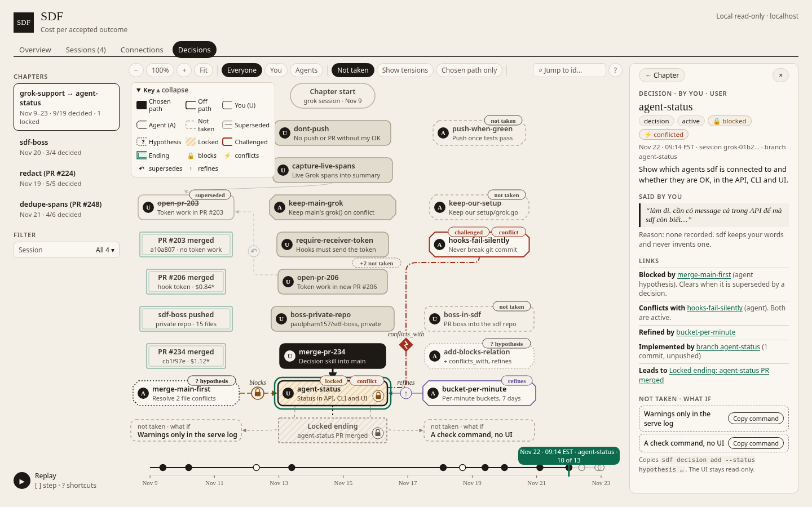
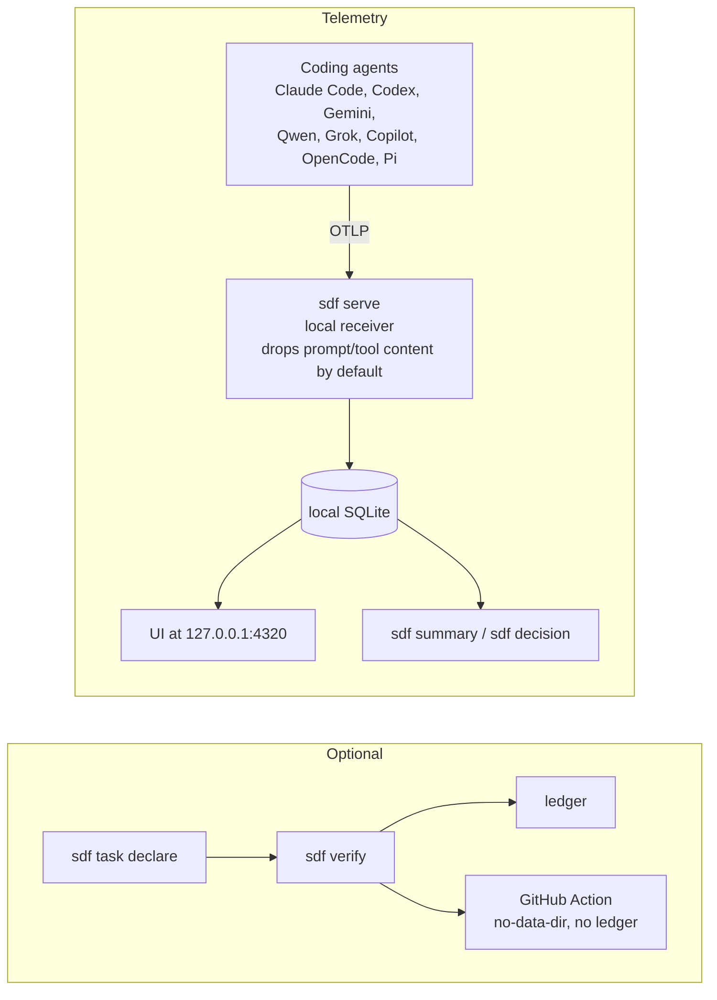

# Software Decision Fabric

A local OpenTelemetry collector and decision ledger for coding agents.

The distinctive figure is cost per accepted outcome. SDF links each
agent's OTLP traces to commits, and with `--github` to the pull
requests for those commits and whether they merged or were closed
without merging. Without `--github`, accepted stays unknown. That
figure is the computed cost of merged sessions, divided by how many
there are — not only token or session counts.

The decision layer records who decided (user or agent), why, and which
alternatives were considered, and links each decision to the sessions and
commits that implemented it. The Decisions graph shows the path taken,
paths not taken, blocked or conflicting points, and the cost of that
chapter's sessions.

SDF runs entirely on your machine: it listens on `127.0.0.1` and stores
data in SQLite. Prompt, response, tool, and error text is dropped before
storing unless you opt in with `--store-content`. You can collect this
information without sending telemetry to an outside SaaS. It does not
launch, route, or sandbox the agents; it only listens. The receiver needs
no API key or network connection.



## Quickstart

You need a supported coding agent already installed, and Go 1.26 or
newer. Install from the [v0.1.0 release](https://github.com/paulpham157/sdf/releases/tag/v0.1.0)
or with:

```bash
go install github.com/paulpham157/sdf/cmd/sdf@latest
sdf serve
```

It listens for OTLP/HTTP on `127.0.0.1:4318` and OTLP/gRPC on
`127.0.0.1:4317`, writes `sdf-telemetry.sqlite` in the current directory,
and serves the UI at <http://127.0.0.1:4320/>. Leave it running. In
another terminal:

```bash
sdf init claude-code --write   # or codex, opencode, pi, qwen, grok, gemini, copilot
sdf init --check
```

Restart the agent so it reads the new settings, use it as usual, then
open <http://127.0.0.1:4320/> or run `sdf summary`.

The full install notes, feature list, and command reference live in the
[repository README](https://github.com/paulpham157/sdf#readme).

## How it works



Agents export OTLP to the local receiver. sdf stores what it needs for
summaries and outcomes, and (by default) drops prompt and tool text
before the row is written. Decisions are recorded separately; the
summary does not infer them from telemetry. Task declaration, verify,
and the ledger are optional and sit beside collection, not in its path.
The `sdf verify` GitHub Action runs with `--no-data-dir` and does not
open the ledger.

## Documentation

| Document | What it covers |
| --- | --- |
| [Agents](agents.md) | What each tool exports, the settings that point it at the receiver, and how an agent gets the decision brief |
| [Receiver](receiver.md) | The receiver, content storage, the UI, `sdf init`, and the git hooks |
| [Summary](summary.md) | How a session is summarized, and how cost is computed |
| [Outcomes](outcomes.md) | Linking a session to a commit or pull request, decision records, and the local budget |
| [File permissions](security.md) | Permissions on the SQLite store and ledger files |
| [Agent skills](skills/README.md) | The `sdf-decisions` skill: record choices with `sdf decision`, run `scripts/brief` at session start, and run `scripts/check` before a push, merge, release, deploy, or architecture change |
| [Check the summary](check.md) | `sdf check` and its cases |
| [Ledger](ledger.md) | The hash-chained ledger, its encoding, `sdf audit verify` and `sdf audit head`, and what it does not protect against |
| [Tasks](tasks.md) | `sdf task declare` and `sdf task show`: a task's acceptance criteria, hashed before an agent runs |
| [Verify](verify.md) | `sdf verify`: run a declared task's checks against a commit, with evidence and a verdict |
| [GitHub Action](action.md) | The `sdf verify` GitHub Action, and its threat model |
| [Gaps](gaps.md) | Known limits of the collector and the summary |
| [Session boundaries](research/session-boundary.md) | How each agent marks session open and close |

The product site is [softwaredecisionfabric.tech](https://softwaredecisionfabric.tech/).
Source, issues, and releases are on [GitHub](https://github.com/paulpham157/sdf).
