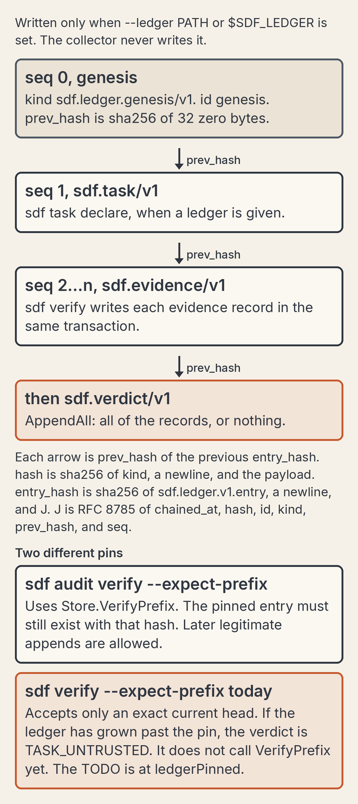

# Ledger

The ledger is an append-only, hash-chained record of canonical payloads:
tasks, attempts, evidence, verdicts. A verifier writes to it through
`internal/ledger`. `sdf audit verify` and `sdf audit head` read it.

[](diagrams/08-ledger-chain.png)

Source: [08-ledger-chain.tldr](diagrams/08-ledger-chain.tldr) (open in [tldraw](https://www.tldraw.com); the official file extension is `.tldr`).

## Who writes it

Writing is opt-in. `sdf task declare` and `sdf verify` write to a ledger
only when you pass `--ledger PATH` or set `$SDF_LEDGER`:

- `sdf task declare` appends the task (`sdf.task/v1`).
- `sdf verify` appends every evidence record (`sdf.evidence/v1`) and then
  the verdict (`sdf.verdict/v1`), all in one transaction: either all of
  them are chained or none is.
- `sdf task show` reads the ledger too when one is given, and never creates
  the file.

With neither set, these commands do not open, create, or read a ledger, and
their output is what it was before the ledger existed. They do not fall back
to the `$XDG_DATA_HOME` or `~/.local/share` paths below; those defaults are
for `sdf audit` only. Because `$SDF_LEDGER` is shared, setting it points
`sdf task declare`, `sdf verify`, and `sdf audit` at the same file.

Before it writes anything else, a command given a ledger prepares it: it
creates the file and table if they are missing and takes the write lock
once (`BEGIN IMMEDIATE`, no entry). A ledger that cannot be written (a
read-only directory, a path that is a directory, a file that is not a
ledger, a lock held past the busy timeout) stops the command with a
`ledger PATH: ...` message: `sdf task declare` exits 1 with no task copy
written, and `sdf verify` exits 3 before any check runs. If an append fails
later anyway, the transaction rolls back and the chain is as it was;
`sdf verify` still prints the verdict JSON, says `ledger: nothing appended`,
and exits 3. A prepared ledger with no entries reads as empty.

The collector does not write to the ledger. Telemetry stays in
`sdf-telemetry.sqlite`. A payload may name a session id or a commit SHA, but
the ledger never copies telemetry.

## Where it lives

One SQLite file, separate from the telemetry store. The path is the first of:

1. `--ledger PATH` on the command,
2. `$SDF_LEDGER`,
3. `$XDG_DATA_HOME/sdf/ledger.db` (when `XDG_DATA_HOME` is an absolute path),
4. `~/.local/share/sdf/ledger.db`.

The first append creates the directory (mode 0700), the file (mode 0600), the
table, and the genesis entry. An existing ledger that group or others can
read is tightened to owner-only when it is opened (see
[security.md](security.md#file-permissions)). (`sdf task declare` and `sdf verify` use only
the first two; see [Who writes it](#who-writes-it).) Preparing a ledger for a
write creates the directory, file, and table but no entry; genesis still comes
with the first append. `sdf audit` on a path that does not exist
reports an empty ledger and creates nothing.

### Journal mode, and what a read may touch

The ledger uses SQLite's WAL mode, set by the first append. Reads open the
file read-only (`mode=ro`), and they never change the ledger file.

- **Why WAL.** In the older rollback-journal mode, a writer that crashed
  mid-append leaves a *hot journal*. The next reader has to roll it back,
  which is a write, so a read-only open fails. In WAL mode a reader skips an
  unfinished transaction without writing. `verify` works after a crash.
- **The trade-off.** A WAL reader may create the `ledger.db-wal` and
  `ledger.db-shm` sidecar files next to the ledger if they are missing. That
  changes the directory, not the ledger file. In a read-only directory with no
  sidecars, and with no `-wal` file (so every committed entry is in the main
  file), the reader opens the file with `immutable=1` instead.
- **Older ledgers.** A ledger an earlier build wrote in rollback-journal mode
  stays readable. The next append switches it to WAL. If such a file holds a
  hot journal, a read reports an I/O error (`sdf audit` exits 3) and leaves
  the journal in place. The next append rolls it back and switches the file
  to WAL.
- **Concurrency.** Appends take `BEGIN IMMEDIATE`, so two writers are
  serialized. Readers do not block writers. Every connection waits up to 5
  seconds on `SQLITE_BUSY` (`busy_timeout`). An append that still gets
  `SQLITE_BUSY` or `SQLITE_LOCKED` has rolled back, and it is retried with
  backoff for up to 10 seconds. The handle's lock is released between
  attempts, so other calls on the same handle are not blocked while it waits.
  Commits use `synchronous=FULL`.

## What is stored

One table, `ledger_entries`. Each row is one entry, payload included:

| Column | Meaning |
| --- | --- |
| `seq` | 0 for genesis, then 1, 2, 3 with no gaps |
| `kind` | Payload schema name, such as `sdf.task/v1` |
| `id` | A ULID, or a task id a person chose, under the id rules below |
| `payload` | The canonical bytes, exactly as the writer passed them |
| `hash` | Payload hash |
| `prev_hash` | `entry_hash` of the entry before |
| `entry_hash` | Hash of this entry's own fields |
| `chained_at` | UTC time the entry was written |

`(kind, id)` is unique, and so is `(kind, id)` under ASCII case-folding (see
the id rules). Appending the same `(kind, id)` with the same hash again
returns the stored entry. A different hash for a stored `(kind, id)` is
`ErrConflict`. Nothing updates or deletes a row.

The case rule is checked inside the append transaction, using a plain
(non-unique) index on `(kind, id COLLATE NOCASE)`. It is not a UNIQUE
index, because a ledger written by an earlier build may already hold two
such ids, and a unique index could not be built there. Such a ledger still
opens and takes appends, and `verify` reports the pair as `duplicate`.

`Append` returns `ErrInvalid` for:

- a `kind` that is empty, is not valid UTF-8, or contains a control character.
  A kind with `\n` could share a payload hash with a different kind/payload
  split (`"a"` + `"b\n{}"` versus `"a\nb"` + `"{}"`);
- a `kind` that starts with `sdf.ledger.`. That prefix is reserved, and only
  the genesis entry uses it;
- an `id` that breaks the id rules below. That error is `ErrInvalidID`, which
  wraps `ErrInvalid`.

### Id rules

An id matches `^[A-Za-z0-9][A-Za-z0-9._-]{0,127}$` (`ledger.IDPattern`,
checked by `ledger.ValidID`). This is the same rule as the verifier's
`task.ValidID`, and a test pins the two together. In words:

- 1 to 128 bytes (`ledger.MaxIDLen`);
- ASCII letters, digits, `.`, `_`, and `-` only. That excludes whitespace,
  control characters, path separators (`/`, `\`), `:`, and anything
  non-ASCII, so an id is always valid UTF-8;
- it starts with a letter or digit. So no leading `-` (it can't be read as a
  flag), no leading `.` (not hidden, and never `.` or `..` on its own);
- `..` inside an id, as in `a..b`, is allowed. With no separator it cannot
  leave a directory;
- case is preserved. A canonical ULID is uppercase
  (`01JD5Z9X8Y7W6V5T4S3R2Q1P0N`) and is stored and returned as it is, and
  `Get` matches an id exactly;
- within one kind, two ids may not differ only in ASCII case. After
  `TASK-1`, appending `task-1` or `Task-1` is `ErrConflict`, and the error
  names both ids. That holds whatever the payload is. Appending `TASK-1`
  again with the same hash is still idempotent. Different kinds do not
  collide. This keeps ids safe as file names on case-insensitive file systems
  (macOS and Windows defaults).

`Get` matches an id exactly, case included: after appending `TASK-1`,
`Get(kind, "task-1")` is `ErrNotFound`. Only `Append` folds case, and only
to refuse a case variant. `Get` returns `ErrInvalidID` for a bad id, and
`ErrInvalid` for a kind that is empty, not UTF-8, or has a control
character, in both cases without a lookup. `Verify` reports a stored row
whose id or kind breaks these rules as `modified`.

`Get` checks the row it reads: its fields, its payload hash, and its entry
hash. A row that fails is `ErrCorrupt`, wrapped with the kind and id. `Get`
does not walk the chain; `sdf audit verify` does.

A file that is not a readable SQLite database (garbage, truncated, damaged:
`SQLITE_NOTADB` or `SQLITE_CORRUPT`) gives an error wrapping
`ErrCorruptFile`. Other failures to open or read (permissions, a missing
directory, EIO) are returned as they are.

Every kind, id, and other stored string in an error message or in `sdf
audit` output is quoted (`%q`), or passed through `ledger.Safe`, which
quotes a string with any non-printable character. A stored row cannot write
a terminal escape sequence to the screen (for example `\x1b[2K\r`, which
erases a line). `--json` output escapes control characters as JSON does.

## Encoding

The writer canonicalizes its payload. The verifier uses JCS (RFC 8785). The
ledger treats the payload as opaque bytes and never reserializes it.

```
hash       = "sha256:" + hex(sha256(kind + "\n" + payload))
entry_hash = "sha256:" + hex(sha256("sdf.ledger.v1.entry\n" + J))
```

`hex` is lowercase. `J` is the RFC 8785 serialization of this object:

```json
{"chained_at":"2026-11-23T05:40:00.000000000Z","hash":"sha256:…","id":"…","kind":"sdf.task/v1","prev_hash":"sha256:…","seq":1}
```

- Keys are in that (sorted) order, with no whitespace.
- `seq` is a JSON integer.
- `chained_at` is UTC with exactly nine fraction digits and a `Z`.
- Strings escape only `"`, `\`, and control characters: `\b \f \n \r \t`, and
  otherwise `\u00xx` in lowercase hex.
- JSON cannot carry invalid UTF-8. `"a\xffb"` and `"a\uFFFDb"` would encode
  the same, so the ledger never writes an invalid-UTF-8 field, and it treats a
  stored one as corrupt rather than hashing it.

Append rejects a hash that is not the hash of `kind` and the payload
(`ErrHashMismatch`).

Genesis is seq 0: kind `sdf.ledger.genesis/v1`, id `genesis`, payload
`{"schema":"sdf.ledger/v1"}`, and a `prev_hash` of `sha256:` followed by 64
zeros. Its `chained_at` is set by the first append, so no fixed value can be
checked. Genesis and seq 1 are written in one transaction with the same
timestamp. `verify` checks that genesis has the `chained_at` form and is not
later than seq 1. (A ledger from an earlier build has a genesis a moment
earlier than seq 1, which also passes.)

`internal/ledger/ledger_test.go` has known-answer values computed outside Go,
for checking a writer in another language.

## Prefix pins (library)

Callers that need to accept a ledger that has grown since a checkpoint
use `*Store`. The `Ledger` interface is unchanged, so existing fakes keep
compiling.

```go
func (*Store) GetBySeq(ctx context.Context, seq int64) ([]byte, Entry, error)
func (*Store) VerifyPrefix(ctx context.Context, seq int64, entryHash string) error
func ParsePin(s string) (seq int64, entryHash string, err error)
```

`GetBySeq` looks up a row by seq and validates it the way `Get` does
(fields, payload hash, entry hash). A missing seq is `ErrNotFound`. A
row that fails validation is `ErrCorrupt`, wrapped with the seq, kind,
and id. `GetBySeq` does not walk the chain.

`VerifyPrefix` is the library form of `sdf audit verify --expect-prefix`.
It is nil only when the entry at `seq` exists, its `entry_hash` equals
`entryHash`, and the whole chain verifies, so later legitimate appends
after the pin are allowed.

- A missing seq is `ErrPrefixMismatch` wrapping `ErrNotFound`, so both
  `errors.Is(err, ErrPrefixMismatch)` and `errors.Is(err, ErrNotFound)`
  hold. Truncation below the pin is reported this way.
- A stored `entry_hash` that does not equal `entryHash` is
  `ErrPrefixMismatch`. The message includes expected and actual
  (`seq:hash`); stored strings go through `Safe`.
- A broken chain is a `*ChainError` whose `Unwrap` is `ErrChainBroken`
  and whose `Failure` is the first problem `Verify` found, even if the
  pinned entry still happens to match.
- A negative `seq` is `ErrInvalid` (invalid input), not a prefix mismatch.
- Other failures (I/O, `ErrCorruptFile`, a corrupt row) are returned as
  from `Verify` or `GetBySeq`.

`ParsePin` accepts `SEQ:HASH` (a non-negative seq and `sha256:` plus 64
lowercase hex digits), the line `sdf audit head` prints (`seq N entry_hash
HASH`), or `sdf audit head --json` output. `sdf audit verify
--expect-prefix` and `--expect-prefix-file` use `ParsePin` and
`VerifyPrefix`, so the CLI and the library agree.

## sdf audit

```bash
sdf audit verify [--ledger PATH] [--json] [--require-nonempty]
                 [--expect-head HASH | --expect-head-file PATH
                  | --expect-prefix SEQ:HASH | --expect-prefix-file PATH]
sdf audit head   [--ledger PATH] [--json]
```

`verify` reads every entry in seq order. It checks that genesis is exactly
the entry above, and that each row's fields are ones the ledger would write
(TEXT columns, valid UTF-8, no control characters in `kind`, the reserved
prefix, the `chained_at` form). It recomputes each payload hash and entry
hash, checks that each `prev_hash` links to the entry before, and checks that
no `(kind, id)` appears twice. It reports the first failure:

- `modified`: a payload or an entry's own field no longer hashes to what was
  chained, a field holds something the ledger would never write, or genesis
  is not exact.
- `missing`: a seq is absent (a deleted row), or genesis is gone.
- `gap-reordered`: a `prev_hash` does not link to the entry before. A row was
  moved or inserted, or an earlier entry was rewritten along with its hashes.
- `duplicate`: a `(kind, id)` is stored twice, or two ids of one kind differ
  only in ASCII case.

An intact ledger prints the head seq and its `entry_hash`.

An empty or absent ledger is intact, so a mistyped path passes. Add
`--require-nonempty` to make an absent or empty ledger exit 1.

A chain with its newest entries deleted, or with earlier entries rewritten
and every hash recomputed, is still a valid chain. To catch that, pin a
checkpoint you recorded earlier:

- `--expect-prefix SEQ:HASH` checks that the entry at `SEQ` still exists,
  its `entry_hash` still equals the pinned hash, and the full chain verifies.
  Later legitimate appends are allowed. This is the mode to use for a
  ledger that keeps growing.
- `--expect-prefix-file PATH` reads the same pin from a file. The file can
  hold `SEQ:HASH`, the line `sdf audit head` prints, or
  `sdf audit head --json` output. A missing or otherwise unreadable path
  is an I/O error (exit 3). A malformed pin is a usage error (exit 2).
- `--expect-head sha256:…` requires the current head's `entry_hash` to
  equal the pinned hash exactly. Use this when the ledger must not have
  grown.
- `--expect-head-file PATH` reads that hash from a file (bare hash, the
  `sdf audit head` line, or `sdf audit head --json` output).

These four flags cannot be used together. An `--expect-head` pin requires
an exact match: after a legitimate append, pin the new head. An
`--expect-prefix` pin allows later appends. Verify exits 1 in each of
these cases:

- The pin does not match (`--expect-head`: the current head;
  `--expect-prefix`: the entry at the pinned seq). It prints expected and
  actual.
- The ledger is empty. It prints `actual none`.
- The chain is broken. It says the stored head or prefix proves nothing
  (`head not accepted` / `prefix not accepted`).

`--json` reports `ok` (every check), `chain_ok` (the chain alone),
`require_nonempty`, `expected_head`, `head_match`, `expected_prefix`, and
`prefix_match`.

`head` verifies first. It prints `seq N entry_hash sha256:…` only for an
intact, non-empty ledger. Otherwise it prints nothing to stdout. Use it to
copy the head somewhere else.

### Exit codes

| Code | `verify` | `head` |
| --- | --- | --- |
| 0 | Intact, and every requested check passed | Head printed |
| 1 | Broken chain, a file that is not a readable ledger database (garbage, truncated, damaged), `--require-nonempty` on an empty ledger, or an `--expect-head` / `--expect-prefix` mismatch | Broken, unreadable-as-a-database, or empty ledger |
| 2 | Usage: unknown flag, missing value, more than one expect flag, or a pin that is not the required form (`sha256:` + 64 lowercase hex, or `SEQ:HASH`) | Usage |
| 3 | I/O: the ledger cannot be opened or read (a directory, permissions, EIO, a hot journal in an old rollback-mode file), no default path, or an unreadable `--expect-head-file` or `--expect-prefix-file` (a missing path included) | I/O, as for `verify` |

For a file that is not a ledger database, and for exit 3, the message goes
to stderr and nothing goes to stdout, `--json` included.

### Pinning the head in CI

The [`sdf verify` GitHub Action](action.md) lives in this repository
(`.github/actions/sdf-verify`). It does not write or audit a ledger today.
This is how a CI job can pin a checkpoint after `sdf verify --ledger`
appends:

Keep a checkpoint somewhere the agent cannot write. After the CI job appends,
it runs `sdf audit head --json` and stores the output as a CI artifact or on
a protected ref.

A ledger grows with every append, so re-pinning the exact head after every
write is impractical. Prefer prefix mode. The next job, or anyone auditing
later, runs:

```bash
sdf audit verify --require-nonempty --expect-prefix-file pinned-head.json
```

This passes if the entry CI recorded still exists with the same
`entry_hash` and the whole chain verifies. It fails if the
ledger was truncated below that seq or rewritten at or through that point.
Later legitimate appends are allowed; the pin does not need to be updated
after every write.

Use `--expect-head` / `--expect-head-file` only when you need the current
head to equal the pinned hash exactly (the ledger must not have grown).

## What this does not protect against

The chain makes tampering **detectable, not prevented**, and only within
limits:

- The agent runs as the same user as sdf, so it can write this file. It can
  rewrite any entry and recompute every hash after it. It can also delete the
  last entries. The result is a valid chain, and a plain `sdf audit verify`
  passes.
- That is only caught by comparing against a head or prefix hash stored
  **somewhere the agent cannot write** (`--expect-prefix` or
  `--expect-head`). Without such a copy, a rewritten ledger cannot be told
  apart from the real one.
- The intended trust anchor is CI: a job that runs outside the agent's
  machine, such as the [`sdf verify` GitHub Action](action.md), and records
  a checkpoint the agent cannot write. The action does not pin a ledger
  head today, so until a job does that, the local file is a working copy,
  not proof.
- There is no signature and no HMAC. Signing entries or exported heads with a
  key outside the agent's reach is future work.
