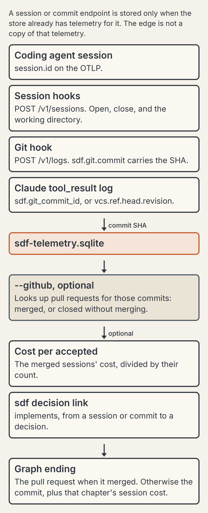
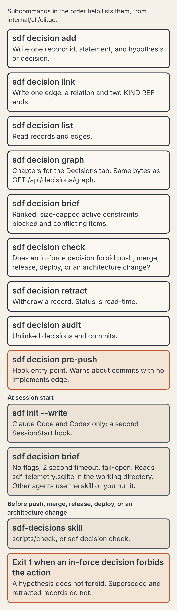
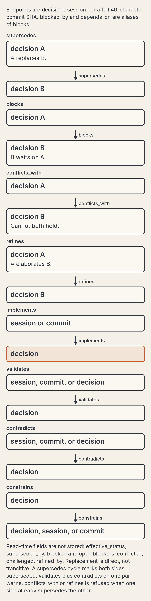
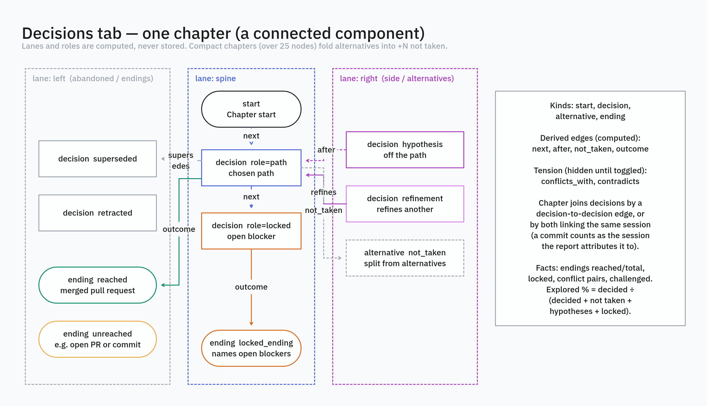

# Outcomes

Telemetry says a tool call succeeded. It does not say the change was merged.
`sdf summary` attaches an outcome from the local checkout, and stops when the
match would be a guess. Nothing in this step calls the network unless you
pass `--github`.

## Linking a session to a commit

[](diagrams/16-session-outcomes.png)

Source: [16-session-outcomes.tldr](diagrams/16-session-outcomes.tldr) (open in [tldraw](https://www.tldraw.com); the official file extension is `.tldr`).

A link is **exact** when `claude_code.tool_result` carries
`vcs.ref.head.revision` or a full 40-character `git_commit_id` (including one
inside `tool_parameters`). Claude Code adds those only when
`OTEL_LOG_TOOL_DETAILS=1`, and an abbreviated id is ignored. The SHA has to
exist in the checkout. If it does not, the session stays unlinked. SDF does
not substitute a hook commit or a different commit from the same window.

A link is **hook** when an `sdf.git.commit` log from `sdf init --git-hooks`
is already on this session. The hook copied the session id the agent put in
the environment, so the SHA is that session's commit. Several commits in one
session are all kept. A `post-rewrite` event drops the SHA it replaced.
The checkout path on the event is used to verify the object when `--repo`
is not set. `--repo PATH` is that checkout instead, including when the path
on the hook event still exists on disk. If `--repo` or the hook path
disagrees with a working directory the agent exported, the session stays
unlinked. A hook SHA that is not in this checkout can still match an
`SDF-Session` line in a commit that is. A missing exported SHA does not fall
through to the hook.

A link is **trailer** when a commit message has a line `SDF-Session: <id>`
for this session id. Summary reads that line from the message. It does not
use git's trailer block, which keeps only the last block: a GitHub squash
message often puts a blank line and then `Co-authored-by` after the session
line, and that block would hide `SDF-Session`. The line is how a squash
merge can stay attributed after the original SHA is gone, and only when the
squash message still contains it. See [Git hooks](receiver.md#git-hooks).

A link is **heuristic** when none of those fired, the session has one
absolute working directory (`pi.cwd` from pi-otel, a single
`workspace.host_paths` value from Claude Code, or `sdf.session.cwd` from the
Grok CLI session hook that `sdf init grok --write` installs), that directory is a git
checkout on this machine, and exactly one commit has a committer time inside
the session window widened by two seconds. Zero commits, or more than one,
stays unlinked. The same commit in two sessions' windows unlinks both.
A commit that carries an `SDF-Session` trailer, or that a hook already
attributed to another session, is not given out by the heuristic.
`--repo PATH` supplies a checkout when the telemetry has no directory, and
it is the checkout used for a hook or trailer link when you pass it. If it
disagrees with a directory the agent did export, the session stays unlinked.

Without the git hooks, Codex and OpenCode do not export a working directory
or a commit SHA on the signals this receiver stores, so those sessions stay
unlinked unless you pass `--repo` and the time window contains one commit.
Grok CLI's telemetry has none either, and Grok ignores
`OTEL_RESOURCE_ATTRIBUTES`, so one cannot be added there; the Grok session
hook from `sdf init grok --write` supplies `sdf.session.cwd`, and `--repo`
remains the fallback when that hook is not installed (see
[Grok CLI](agents.md#grok-cli)).
Pi exports `pi.cwd` and can use the heuristic, and the hook when the
session file stem matches `pi.session.id`. A commit with no session id is
not attached to a session by the hook. Under Codex's default
`workspace-write` sandbox the hook does not run, because `.git` is
read-only. See [Git hooks](receiver.md#git-hooks).

## Pull requests and CI

`--github` asks for the pull request and CI status of a commit that is already
linked. It uses `gh` when `gh` is on `PATH`, and otherwise `GH_TOKEN` or
`GITHUB_TOKEN` against `api.github.com`. The token is a header, not an
argument. The remote has to be `github.com`. The commit's pull request list
is `GET /repos/{owner}/{repo}/commits/{sha}/pulls`. That list is empty for a
closed pull request that was not merged. When it is empty and the hook
recorded a branch for that commit, summary lists
`GET /repos/{owner}/{repo}/pulls?state=all&head={owner}:{branch}` and keeps
a pull request whose head is that commit. A closed, unmerged pull request
is then reported, `accepted` is false, and the reason says the pull request
was closed without merging. No pull request means not accepted. Several
pull requests, or a failed query, means accepted is unknown. CI is
`success`, `pending`, `failure`, or `none`. GitHub's combined status is
`pending` with `total_count` 0 when the commit has no statuses. That is
`none` when there are no check runs either, not a pending check.

`cost_per_accepted_outcome_usd` is the sum of `computed_cost_usd` for sessions
whose pull request is merged, divided by how many such sessions there are.
It is `unknown`, not zero, when any session in the set has no known outcome,
when an accepted session has unknown computed cost, when the same commit is
accepted on two sessions, or when nothing was merged.

## Decision records

[](diagrams/04-decision-commands.png)

Source: [04-decision-commands.tldr](diagrams/04-decision-commands.tldr) (open in [tldraw](https://www.tldraw.com); the official file extension is `.tldr`).

A decision is something a caller writes down. The summary does not infer one
from telemetry, and recording one changes nothing about collection or
summarization.

Each record has an id, one statement, and a status of `hypothesis` or
`decision`. A hypothesis is an assumption, not a settled fact. Optional fields
name who decided, the alternatives that were on the table,
a reason, a source pointer, and a category. Time is `recorded_at`.

`decided_by` is the GitHub login of the team member responsible, for example
`paulpham157`. An agent acting for a person records that person's login.
A person-set rule or constraint is the exception: record it with
`--decided-by user` until a later spec makes an active settled `policy`
a constraint. That stored word displays as `user (legacy)` and is what
the session-start brief locks. Everything else uses the responsible
person's login.
sdf does not distinguish a person from their agent, and it does not check
that the account exists. A login is letters, digits, and single hyphens, at
most 39 characters. It cannot start or end with a hyphen, and it cannot
contain `--`. GitHub compares logins without regard to case. sdf stores the
value as given and does not fold it, so `Paul` and `paul` are different
stored strings. The brief lock matches the exact word `user`. The legacy
words `user` and `agent` are still accepted and are not rewritten. List,
brief, check, and the UI print them with a legacy marker (`user (legacy)`).
JSON keeps the stored string and sets `decided_by_legacy` true for that pair
only. Empty stays empty and prints as `-`. When `--decided-by` is omitted,
sdf stores the first login it can read locally, and it does not use the
network. This is a deviation from the attribution proposal, which named
`gh api user`: the binary runs `gh config get -h github.com user` (the
`user` key for github.com in the GitHub CLI's hosts.yml), then
`git config --get github.user`. The hosts.yml login takes precedence over
`github.user`. That git read uses every scope, including
the repository-local config, and the value is self-asserted attribution, not
authentication. `git config user.name` is not read. A missing `gh`, a failed
command, a display name, or `user` or `agent` in any case (`User`, `AGENT`)
is skipped, and the field stays empty. `gh` has up to 3 seconds. If it
hangs or fails, `git` still gets about 500ms of its own, so the add stays
within a worst case of about 4.5 seconds: gh has 3 seconds, git has 0.5 seconds after that, and each killed command may take another 0.5 seconds to close its pipes. Each command's stdout is capped at 64 KiB. The
lookup runs only after the rest of the record validates. An explicit empty `--decided-by` stays empty
and does not fall through. An explicit value is stored with its exact case.
`User` is not the legacy word `user`. An explicit value that is not a login or `user`
or `agent` is rejected and the add stores nothing. There is no warning that
tries to tell a person from an agent.

`category` is optional. The values are `architecture`, `policy`, `product`,
`implementation`, and `operations`. Unset is stored as SQL `NULL` and
displayed as `implementation`. Explicit `--category implementation` stores
the token. Omitting the flag, or `--category=`, stores `NULL`. JSON omits
`category` when it is unset; a missing key means `implementation`.
`policy` requires `status` `decision`. `sdf decision check` does not read
`category`. The design record is
[Decision categories](design/decision-category.md).

A session is not stored
on the record; link it with an edge when the store already has that session.
An edge connects two endpoints and uses one of
`constrains`, `implements`, `supersedes`, `validates`, `contradicts`,
`blocks`, `conflicts_with`, or `refines`. `blocked_by` and `depends_on` are
accepted as aliases of `blocks` (see Link rules). An
endpoint is a decision id, a session id, or a full 40-character commit SHA. A
session or commit endpoint is stored only when the store already has telemetry
for it; the edge is not a copy of that telemetry. A commit SHA is matched
without regard to case, so a SHA the agent exported in uppercase still matches
the lowercase ref the edge stores.

`GET /api/decisions` returns the records and edges in insertion order. An empty
store returns empty lists. `sdf decision add` writes one record. It needs an id,
a statement, and a status of `hypothesis` or `decision`. `--decided-by`,
`--category`, `--alternatives`, `--reason`, and `--source` are optional.
`sdf decision link`
writes one edge. It needs a relation and two `KIND:REF` endpoints, where
`KIND` is `decision`, `session`, or `commit`. No route writes a record.
`sdf decision brief` prints a ranked, size-capped prefix of the active
constraints, blocked records, and conflicting records
(see Decision brief). `sdf decision check` reports whether an in-force
decision forbids an action (see Checking an action). An agent skill that
uses these commands is in [skills/sdf-decisions](../skills/sdf-decisions/SKILL.md),
with helpers in [`scripts/`](../skills/sdf-decisions/scripts/).

### Link rules

[](diagrams/03-decision-relations.png)

Source: [03-decision-relations.tldr](diagrams/03-decision-relations.tldr) (open in [tldraw](https://www.tldraw.com); the official file extension is `.tldr`).

`sdf decision link` checks an edge before storing it, and stores nothing when a
check fails. It exits 1 with one `sdf decision link: ...` line on stderr, the
same as for an unknown session, commit, or decision. Usage errors, such as a
missing flag, exit 2.

| Relation | Valid direction | Extra checks | Drives at read time |
| --- | --- | --- | --- |
| `supersedes` | decision → decision: `from` replaces `to` | cycle | `effective_status`, `superseded_by` |
| `blocks` | decision → decision: `to` cannot be settled or acted on until `from` is settled | cycle; warns when the pair also has `supersedes` or `conflicts_with` | `blocked_by`, `open_blockers`, `blocked` |
| `conflicts_with` | decision ↔ decision: the two cannot both hold. Symmetric | stored in canonical order; refused when one already supersedes the other | `conflicts_with`, `conflicted` |
| `refines` | decision → decision: `from` elaborates, narrows, or partly amends `to`, which still holds | cycle; refused when one already supersedes the other | `refined_by` |
| `implements` | session or commit → decision: the work implements the decision | | nothing |
| `validates` | session, commit, or decision → decision: evidence that it holds | warns when the pair also has `contradicts` | `challenged` |
| `contradicts` | session, commit, or decision → decision: evidence against it | warns when the pair also has `validates` | `challenged` |
| `constrains` | decision → decision, session, or commit: the decision is a rule that limits it | | nothing |

Every endpoint kind in the second column is enforced. `constrains` is a rule,
not an ordering: use `blocks` for "this must wait for that".

**Aliases.** `--relation blocked_by --from decision:b --to decision:a` and
`--relation depends_on --from decision:b --to decision:a` both store
`a blocks b`. An alias is never stored, and it is the same edge as the
canonical form for the duplicate and cycle checks. Refs and endpoint kinds
are checked as typed, before the swap, so the message names the alias and the
flag you gave: `depends_on links a decision to a decision: to is session:sess-1`.

**Canonical order.** `conflicts_with` between two decisions is stored with the
endpoint that sorts first (`decision:ID`, byte order) as `from`. `a
conflicts_with b` and `b conflicts_with a` are therefore one edge, and the
second is refused as a duplicate whichever order it was given in.

Every relation also has these rules:

- **Self-link.** `from` and `to` cannot be the same endpoint. The message is
  `an edge cannot link an endpoint to itself: decision:a`.
- **Retracted.** A retracted decision takes no new edges, at either end and
  for any relation. The message is
  `decision retracted: decision:a takes no new edges`. Edges recorded before
  the retraction stay. See Retracting a decision.
- **Duplicate.** The same relation, `from`, and `to` cannot be stored twice.
  A commit SHA is compared in lowercase. The message is
  `edge already recorded: decision:a constrains decision:b`. The other
  direction, or another relation between the same two endpoints, is a
  different edge.
- **Endpoint kinds.** An endpoint of a kind the relation does not take (see
  the table) is rejected before the store is asked whether the ref exists. The
  message names the rule and the end, for example
  `supersedes links a decision to a decision: from is session:sess-1`,
  `blocks links a decision to a decision: to is commit:SHA`,
  `implements links a session or commit to a decision: from is decision:a`,
  `validates points to a decision: to is session:sess-1`, or
  `constrains starts from a decision: from is session:sess-1`.
- **Cycles.** `supersedes`, `blocks`, and `refines` each reject an edge that
  would close a cycle through edges of the same relation. `a supersedes b` is
  rejected when `b` already reaches `a` through `supersedes` edges, including
  `b supersedes a`. The message names the path, for example
  `supersedes cycle: decision:c already reaches decision:a through supersedes (c -> b -> a), so decision:a cannot supersede decision:c`,
  and in the same form `blocks cycle: ... so decision:c cannot block decision:a`
  and `refines cycle: ... so decision:c cannot refine decision:a`. A blocks
  cycle would be a deadlock. Two decisions may supersede, block, or refine the
  same one, and edges of other relations do not count toward a cycle.
- **Already superseded.** `conflicts_with` and `refines` are refused between
  two decisions when one already supersedes the other, in either direction:
  `pair already linked by supersedes: decision:a and decision:b; one already replaces the other, so refines is not recorded`.
  The other way round is allowed: `supersedes` after `conflicts_with` is
  stored, and resolves the conflict.
- **Blocks over a linked pair.** A `blocks` edge between two decisions that
  already have a `supersedes` or `conflicts_with` edge is stored, and prints
  `sdf decision link: warning: decision:a and decision:b also have a conflicts_with edge`.
- **Validates and contradicts.** When the same two endpoints, in either
  direction and in either order, end up with both a `validates` and a
  `contradicts` edge, the edge is still stored and the command exits 0. It
  prints
  `sdf decision link: warning: session:sess-1 and decision:a have both validates and contradicts edges`
  on stderr.

The duplicate, cycle, and warning checks read the stored edges inside the same
SQLite transaction as the insert (`BEGIN IMMEDIATE`, which takes the write lock
first). Two `sdf decision link` runs at the same moment therefore cannot both
pass a check that only one of them should. The checks only read: no edge or
record is updated or deleted. Edges that an older sdf stored without these
checks stay readable, count as existing edges for the duplicate and cycle
checks, and are handled at read time as described below.

**Older rows that break the endpoint kinds.** Before the kinds were enforced,
sdf stored `implements`, `validates`, `contradicts`, and `constrains` between
any known endpoints, for example `decision:a implements decision:b`. Such a
row is kept as stored: nothing is rewritten or deleted, `sdf decision list`,
`GET /api/decisions`, and the UI list it with the other edges, and it still
counts as an existing edge for the duplicate check. It drives no read-time
field: `challenged` counts a `validates` or `contradicts` edge only when it
points to a stored decision, and `implements` and `constrains` drive nothing.
The same holds for any `blocks`, `conflicts_with`, or `refines` row with a
session or commit end, a self-link, or an id never stored. Writing the same
row again is refused by the kind check, which runs before the duplicate
check. No HTTP route writes
an edge, so `sdf decision link` is the only way to write one.

### Blocked, conflicted, refined, and challenged at read time

These fields are computed each time the records are read, like
`effective_status`, and are never stored. Each is omitted from JSON when it is
empty or false, so a store without these relations reads exactly as before.
`effective_status` keeps its values (`active`, `superseded`, `retracted`);
the new fields sit beside it. Only an edge between two different stored
decisions counts for `blocks`, `conflicts_with`, and `refines`. Ids are listed
once each, in the order the edges were recorded.

- `blocked_by`: every decision with a `blocks` edge to this one.
- `open_blockers`: the blockers that are still unsettled. Records never change
  status, so a hypothesis is settled by superseding it with a decision record.
  sdf follows `superseded_by` from the blocker to its current heads, the active
  decisions at the end of each replacement path. A retracted decision on the
  way contributes no head, because a withdrawn blocker blocks nothing. The
  blocker is open when any head has status `hypothesis`. So a blocking
  hypothesis stays open when another hypothesis replaces it, and clears once a
  `decision` record replaces it or it is retracted. A blocker that was
  recorded as a `decision` is settled from the start. A blocker that reaches
  no head is open when any path of its `supersedes` chain runs into a cycle
  (rows an older sdf stored), even if its other paths end in a retraction: no
  decision record settled it. It is settled only when every path ends in a
  retraction.
- `blocked`: `true` when the record is `active` and `open_blockers` is not
  empty. A superseded or retracted record is never blocked, though its
  `blocked_by` and `open_blockers` are still listed.
- `conflicts_with`: the other side of every `conflicts_with` edge, from either
  end.
- `conflicted`: `true` when the record is `active` and at least one of those
  is `active`. Superseding or retracting one side resolves the conflict; the
  pair stays listed.
- `refined_by`: every decision with a `refines` edge to this one. The refined
  record keeps its own `effective_status`; `refines` never supersedes.
- `challenged`: `true` when the record is `active` and the latest `validates`
  or `contradicts` edge to it, in edge order, is `contradicts`. A later
  `validates` clears it. A `validates` or `contradicts` edge from a decision
  that is not `active` (retracted or superseded) is ignored, as a withdrawn
  blocker blocks nothing: it neither challenges nor clears a challenge. One
  from a session or commit always counts.

`sdf decision list` adds `, blocked`, `, conflicted`, and `, challenged` to
the `EFFECTIVE` cell, in that order, and prints `blocked by: IDS (open: IDS)`
(or `(settled)`), `conflicts with: IDS`, and `refined by: IDS` lines under the
statement:

```text
Decisions: 6
ID             STATUS      CATEGORY        EFFECTIVE           DECIDED BY       RECORDED AT                       SOURCE  STATEMENT
which-db       hypothesis  implementation  active              agent (legacy)  2026-11-23T17:18:46.360788+00:00  -       Pick the store: SQLite or Postgres.
design-schema  decision    implementation  active, blocked     agent (legacy)  2026-11-23T17:18:46.367151+00:00  -       Design the rejections schema.
                                                                                                                       blocked by: which-db (open: which-db)
use-sqlite     decision    implementation  active, conflicted  user (legacy)   2026-11-23T17:18:46.373929+00:00  -       Keep the store in SQLite.
                                                                                                                       conflicts with: use-postgres
use-postgres   decision    implementation  active, conflicted  agent (legacy)  2026-11-23T17:18:46.381759+00:00  -       Move the store to Postgres.
                                                                                                                       conflicts with: use-sqlite
dont-push      decision    implementation  active              user (legacy)   2026-11-23T17:18:46.390932+00:00  -       Do not push without an OK.
                                                                                                                       refined by: push-after-ok
push-after-ok  decision    implementation  active              user (legacy)   2026-11-23T17:18:46.397456+00:00  -       Push feature branches once the user says OK.

Edges: 3
RELATION        FROM                    TO                      RECORDED AT
blocks          decision:which-db       decision:design-schema  2026-11-23T17:18:46.403783+00:00
conflicts_with  decision:use-postgres   decision:use-sqlite     2026-11-23T17:18:46.410590+00:00
refines         decision:push-after-ok  decision:dont-push      2026-11-23T17:18:46.418467+00:00
```

The edges above were written with `depends_on` (design-schema on which-db),
`conflicts_with` from use-sqlite to use-postgres, and `refines`; the table
shows the stored, canonical form. The UI writes blockers as the list does,
"blocked by IDS (open: IDS)" or "blocked by IDS (settled)": next to a blocked
record, else on its detail line. It shows "conflicts with" (only the sides
still active) and "challenged" next to the record, and "refined by" and
resolved conflicts on its detail line.

### Superseded at read time

A `supersedes` edge reads as "`from` supersedes `to`": the `from` decision
replaces the `to` decision. Only an edge between two different decisions,
both of them stored records, counts. `sdf decision link` no longer stores a
`supersedes` edge with a session or commit endpoint, a self-link, or a cycle
(see Link rules). A database written by an older sdf may still hold such
edges, or an edge naming a decision id that was never stored. Those edges stay
as stored and are listed with the other edges, but they change no status. The
cycle check uses the same rule, so it does not follow them either.

The stored record never changes. Each time the records are read, every record
gets two fields that are not stored:

- `effective_status`: `superseded` when at least one decision supersedes it,
  otherwise `active`. `status` stays what was recorded (`hypothesis` or
  `decision`).
- `superseded_by`: the ids of the decisions that supersede it, once each, in the
  order the edges were recorded. It is omitted when the record is active.

Replacement is direct, not transitive. If `b` supersedes `a` and `c` supersedes
`b`, then `a` is superseded by `b`, `b` is superseded by `c`, and `c` is
active. To find the latest replacement, follow `superseded_by`. A cycle, such as
`a` and `b` superseding each other, marks both superseded. `sdf decision list`,
`GET /api/decisions`, and the UI show the same values, because all three read
them from the same code. The UI shows "superseded by ID" next to the record.

`sdf decision list` prints the records and then the edges, each as a table in
insertion order. Columns are `ID`, `STATUS`, `CATEGORY`, `EFFECTIVE`,
`DECIDED BY`, `RECORDED AT`, `SOURCE`, and `STATEMENT`. An empty category
prints as `implementation`. An empty source or `DECIDED BY` prints as `-`.
`user` and `agent` print as `user (legacy)` and `agent (legacy)`. When a record
has alternatives or a reason, each follows its row on its own line in the
`STATEMENT` column, as `alternatives: TEXT` and `reason: TEXT`. They are free
text up to 500 bytes, so they are kept out of the columns. `--json` carries
the same fields as `decided_by`, `decided_by_legacy` (true only for stored
`user` or `agent`), `alternatives`, `reason`, and `category` when one was
stored. A cell that holds a
non-printing character, such as a tab, DEL, or a right-to-left override like
U+202E, or that is not valid UTF-8, is printed Go-quoted so it cannot break the
columns or reorder the terminal line. Every column follows this rule, including
`EFFECTIVE`, `DECIDED BY`, and the alternatives and reason values (the label
stays outside the quotes), and any column added later must too. `--json` does not quote: it
leaves DEL and RTL characters raw in the JSON strings, exactly as
`GET /api/decisions` does, so a reader that prints JSON values to a terminal
has to escape them itself.
`sdf decision list --json` prints exactly what `GET /api/decisions` returns,
because both read the store through the same code. `--session ID` is not
that response: it keeps only the edges that touch `session:ID` and the
decisions those edges name, in the same insertion order, and drops the
rest. With no such edge the text is `No decisions in the store.` and
`--json` is the empty lists. `--category` keeps a stored token, and
`--category implementation` also keeps a NULL category, which displays as
`implementation`. `--category none` keeps a stored string outside the five
tokens, except the text `none`, and does not keep NULL. An edge stays when
at least one of its decision endpoints survived the filter. `--session` is
applied first, then `--category`. When the store has records and
`--category` keeps none of them, the text is `No decisions match.` and
`--json` is the empty lists. That is not the empty-store line. Like `sdf summary`, it reads
`sdf-telemetry.sqlite` unless `--db` names another file, and it opens the file
read-only: it never writes, never migrates, and never creates a file. With no
records and no edges it prints `No decisions in the store.`, and `--json`
prints empty lists. A file that does not exist, in a directory that does, reads
as such an empty store and is not created (exit 0). A missing directory exits
1 with `sdf decision list: store: cannot open "PATH": directory "DIR" does not
exist`, the same message `sdf summary` gives. A file written before a later
column or table, such as one without `decision_retractions`, is read as is:
the missing columns read as empty and the missing table as no retractions.

```bash
sdf decision add --id use-sqlite --statement "Store telemetry in SQLite" \
  --status decision [--decided-by LOGIN] \
  [--category architecture|policy|product|implementation|operations] \
  [--alternatives TEXT] [--reason TEXT] [--source TEXT] [--db PATH]
sdf decision link --relation implements --from session:SESSION_ID \
  --to decision:use-sqlite [--db PATH]
sdf decision link --relation supersedes --from decision:use-wal \
  --to decision:use-sqlite [--db PATH]   # use-wal replaces use-sqlite
sdf decision list [--db PATH] [--json] [--session ID] [--category architecture|policy|product|implementation|operations|none]
sdf decision graph [--db PATH] [--json] [--prices bundled|PATH] [--repo PATH] [--github]
sdf decision brief [--db PATH] [--max-items N] [--max-bytes N] [--format text|json]
sdf decision check push|merge|release|deploy|TEXT [--db PATH] [--json]
sdf decision retract --id use-sqlite [--reason TEXT] [--retracted-by user|agent] [--db PATH]
sdf decision audit [--db PATH] [--json] [--since RFC3339] [--until RFC3339]
sdf decision recall [--db PATH] [--json] [--since DURATION|RFC3339] [--until RFC3339]
sdf decision pre-push [--db PATH] [--remote NAME] [--mode warn|block|off] < pre-push lines
```

`--decided-by` is the responsible person's GitHub login. The exception is a
person-set rule or constraint: record that with `--decided-by user` until a
later spec makes an active settled `policy` a constraint. That value displays
as `user (legacy)`. Everything else uses the login.

```text
Decisions: 3
ID          STATUS      CATEGORY        EFFECTIVE              DECIDED BY      RECORDED AT                       SOURCE     STATEMENT
use-sqlite  decision    implementation  superseded by use-wal  user (legacy)   2026-11-23T15:00:00.000000+00:00  issue 168  Store telemetry in SQLite
                                                                                                                                     alternatives: Postgres, DuckDB
                                                                                                                                     reason: One file, no server
pure-go     hypothesis  implementation  active                 agent (legacy)  2026-11-23T15:00:01.000000+00:00  -          The driver stays pure Go
use-wal     decision    implementation  active                 -               2026-11-23T15:00:02.000000+00:00  -          Store telemetry in SQLite with WAL

Edges: 2
RELATION    FROM              TO                   RECORDED AT
constrains  decision:pure-go  decision:use-sqlite  2026-11-23T15:00:03.000000+00:00
supersedes  decision:use-wal  decision:use-sqlite  2026-11-23T15:00:04.000000+00:00
```

### Retracting a decision

`sdf decision retract --id ID [--reason TEXT] [--retracted-by user|agent]`
withdraws a decision without deleting or changing it. It appends one row to its
own table, `decision_retractions`: the decision id, the optional one-line
reason, who retracted it (`user` or `agent`, optional), and when, filled by sdf.
The `decisions` and `decision_edges` rows stay exactly as they were. Like `add`
and `link`, it prints nothing on success. It exits 1 when the store refuses and
2 on a usage error.

A retraction is a row in its own table and not an edge, for three reasons:

- It has one subject and a reason, which an edge has no column for.
- A `UNIQUE` decision id lets the database itself hold "at most once".
- An older sdf ignores a table it does not know, while it would list an
  unknown `retracts` edge.

Rules:

- **Unknown id.** Retracting an id that was never recorded is rejected with
  `unknown reference: decision ID`.
- **Already retracted.** Retracting a decision a second time is rejected, as a
  duplicate edge is, with
  `decision already retracted: ID at RETRACTED_AT`. The first retraction, and
  its reason, stay as recorded. The check and the insert run in one
  `BEGIN IMMEDIATE` transaction, so concurrent retracts store one row.
- **No new edges.** A retracted decision cannot be linked or superseded again,
  in either direction. To replace a retracted choice, add a new decision; it
  needs no `supersedes` edge to the retracted one. Edges recorded before the
  retraction stay and are still listed.

At read time, `effective_status` is `retracted`. A `retraction` object carries
`retracted_at`, plus `reason` and `retracted_by` when set. Precedence is
**retracted > superseded > active**. A decision that is both retracted and
superseded reads `retracted`, and `superseded_by` is still listed, so neither
fact is lost. Retraction changes only the retracted record. If `b` supersedes
`a` and `b` is later retracted, `a` stays `superseded` (by `b`). sdf does not
guess that `a` is back in force; record a new decision if it is.
`sdf decision list` shows `retracted` (or `retracted, superseded by ID`) in
`EFFECTIVE`, and a
`retracted: TIME [by WHO][; reason: TEXT]` line under the statement, quoted by
the same cell rule as every column. The UI shows the same, and `--json` equals
`GET /api/decisions`.

```text
ID          STATUS    CATEGORY        EFFECTIVE                         DECIDED BY     RECORDED AT                       SOURCE  STATEMENT
use-sqlite  decision  implementation  retracted, superseded by use-wal  user (legacy)  2026-11-23T15:00:00.000000+00:00  -       Store telemetry in SQLite
                                                                                                                                 retracted: 2026-11-23T15:00:03.000000+00:00 by user; reason: Benchmark was wrong
use-wal     decision  implementation  active                            -              2026-11-23T15:00:01.000000+00:00  -       Store telemetry in SQLite with WAL
```

**Migration.** Opening a store runs `CREATE TABLE IF NOT EXISTS
decision_retractions`, in its own migration step, after the existing column
migration. It only adds a table: no column or table changes, and running it
again does nothing. A database written before this, including the Python
receiver's, gains the empty table on its first open by a command that writes
(`sdf decision add`, `link`, `retract`, or the receiver). `sdf summary`,
`sdf decision list`, `sdf decision brief`, and `sdf decision audit` open
read-only and do not add it. An older sdf binary reads a newer database as
before. It does not know the table, so it shows a retracted decision by its
stored status and edges, without the retraction. A file that
cannot be written, such as a read-only copy, is opened without the table and
reads as having no retractions, as does any file `sdf decision list` reads
before a writing command has added the table. `retract` then fails on it.

### The decision graph (Decisions tab)

[](diagrams/05-decision-graph.png)

Source: [05-decision-graph.tldr](diagrams/05-decision-graph.tldr) (open in [tldraw](https://www.tldraw.com); the official file extension is `.tldr`).

`GET /api/decisions/graph` arranges the decision records into chapters for the
UI's Decisions tab. `sdf decision graph --json` prints the same bytes for the
same `--db`, `--prices`, `--repo`, and `--github`, because both call
`decisiongraph.Build` on the same records and the same summarized sessions
(`outcome.Summarize`, without the budget: a budget file that fails to load
breaks `/api/summary`, not the Decisions tab). The route answers through the
same buffered JSON writer as the other routes, with `Content-Length`. Under
`sdf serve`, requests that arrive while the summary is being built share
that build, so the page's parallel requests make one round of GitHub
lookups.
Without `--json` it prints one line per chapter with its facts and explored
count, plus one line per item that needs attention. It opens the store
read-only, like `sdf decision list`. It only reads; the tab has no write
action.

```bash
sdf decision graph [--db PATH] [--json] [--prices bundled|PATH] [--repo PATH] [--github]
```

- **Chapter.** One connected component of decisions. Decisions are joined by a
  decision-to-decision edge, or by both linking the same session (a commit
  counts as the session the report attributes it to). Its title is the git
  branch of the hook commits, else the pull request, else the first session,
  else the first decision id; `label_source` says which. The id is
  `ch-` plus the first decision's id. Chapters are sorted newest first.
- **Nodes.** `start`, `decision`, `alternative` (a not-taken option split from
  `alternatives` on `;`, else on `, or `), and `ending`. `role` is one of
  `path`, `locked`, `hypothesis`, `refinement`, `superseded`, `retracted`,
  `not_taken`, `reached`, `unreached`, and `locked_ending`. `lane`
  (`spine`, `left`, `right`, or `none` for an alternative folded into its
  decision's "+N not taken") and `row` are computed here, so the page only maps
  them to coordinates. Over 25 nodes a chapter is `compact` and folds every
  alternative.
- **Endings.** A linked session's pull request (reached when merged), else its
  first commit, plus any linked commit no linked session stands for. A blocked
  decision on the path with no ending gets a `locked_ending` that names its
  open blockers. `via` lists the decisions that lead to it, `implements` and
  `validates` first.
- **Edges.** The stored edges between decisions, plus derived `next` (the
  chosen path), `after`, `not_taken`, and `outcome`. `tension` marks
  `conflicts_with` and `contradicts`, which the page hides until "Show
  tensions" is on or one end is focused. `relation_types` lists every relation
  with its glyph and label.
- **Facts and explored.** `facts` counts endings reached and total, locked
  records, active conflict pairs (a pair stored in both orders by an older
  sdf is one pair, drawn once), and challenged decisions; `needs_attention`
  lists them. They are the read-time `blocked`, `conflicted`, and
  `challenged` fields above, so the same rules hold: a blocker with no head
  is open when any path of its `supersedes` chain reaches a cycle, a
  conflict pair needs both sides `active`, and only evidence from an active
  decision (or any session or commit) counts; a challenged item names that
  source. `explored` counts choice points only: decided ÷ (decided + not
  taken + hypotheses + locked), rounded half up. A blocked record, decision
  or hypothesis, counts as locked, in `facts.locked` and `explored.locked`
  alike. Superseded and retracted decisions count as decided; a superseded
  or retracted hypothesis, a refinement, and a commit do not count.
- **Cost.** The sum of the chapter's sessions' computed cost: `known`, `partial`
  when some session has no known cost, or `unknown`.
- **What-if.** Each alternative carries `command`, an `sdf decision add ...
  --status hypothesis` line the page copies to the clipboard. The page never
  runs it. The new id is `PARENT-alt-N`; a parent longer than 110 characters
  is cut to 100 and followed by `-` and 8 hex digits of its SHA-256, so the
  id stays within 128 characters and two long parents do not collide.
- **Replay.** A scrubber under the canvas replays the chapter. Its timeline
  has one event per decision (`recorded_at`), per stored edge that touches
  one of the chapter's decisions (`links[].recorded_at`), and per retraction
  (`retraction.retracted_at`), ordered by the full stored time (to the
  microsecond the store writes, not only the millisecond), then decision,
  edge, retraction, then the order the API lists them. A time with no zone
  is read as UTC, the zone the store writes; a time that cannot be read
  sorts last and is labelled "time unknown". It needs no other endpoint.
  Ticks are spaced by event order; filled is a decision stored as `user`,
  hollow one stored as `agent`, accent one stored as a GitHub login, and a
  small dot an edge. The legend names each login. The mark follows the
  stored label. sdf does not check that a person typed `user`. The label
  at the playhead reads, for example,
  `Nov 22 · 09:14 GMT+7 · agent-status · 10 of 13`: the time is in
  the browser's time zone with its label, as every other time on the page.
  The slider is `role="slider"` with `aria-valuemin`, `aria-valuemax`,
  `aria-valuenow`, and `aria-valuetext`: ←/→ or `[`/`]` step one event
  (`[`/`]` work anywhere on the tab outside a text field), PageUp/PageDown
  step a tenth, Home/End jump, Space plays or pauses, and dragging scrubs.
  `#/decisions/<chapter>[/<node>]?at=N` opens the chapter at event N; a
  link to a chapter that no longer exists opens the newest chapter at now
  and ignores `at`. The `?` sheet lists the replay keys.

  As of the playhead, the derived fields are **recomputed, not
  approximated**: the page re-runs the read-time rules above (superseded,
  retracted, blocked with open blockers, conflicted, challenged) over only
  the decisions and edges recorded so far, then rebuilds roles, facts,
  needs attention, and explored the way the graph does. At the last event
  the page shows the server's chapter unchanged. Layout is not recomputed:
  every node keeps its final lane and row, and a node not recorded yet is a
  faint outline with no text, out of the tab order; its panel (reached by
  link) says it is not recorded yet and shows no status chips. Two things are
  approximated because nothing stores their time: an ending appears once
  every decision it came from is recorded and linked to a session or commit,
  and a pull request's merged state is today's. With
  `prefers-reduced-motion`, replay steps without the fade and at a slower
  pace (1.6 s instead of 0.9 s). The live region announces when playback
  starts, pauses, and finishes; each step is in the slider's
  `aria-valuetext`. Open blockers are resolved with the same memoized
  supersedes-head walk as the server (linear in the decisions and edges,
  cycles detected by component), so a step stays fast on long or diamond
  shaped supersedes chains. If a step fails, playback stops and the tab is
  drawn again from scratch.

### Decision brief

`sdf decision brief` prints a short, ranked list of the constraints, blocked
records, and conflicting records that are still active. It is read-only:
it does not write a record, and it does not infer a decision from telemetry.

```bash
sdf decision brief [--db PATH] [--max-items N] [--max-bytes N] [--format text|json]
```

`--max-items` defaults to 15, `--max-bytes` to 2048, and `--format` to `text`.
`--max-items` and `--max-bytes` are non-negative decimals with no sign and no
leading zero. Like `sdf decision list`, it reads `sdf-telemetry.sqlite` in the
working directory unless `--db` names another file, and it opens the file
read-only (`busy_timeout` 200ms, query deadline 500ms). It never writes, never
migrates, and never creates a file. There is no environment variable for the
path.

The list is built from the same graph `sdf decision list` and
`GET /api/decisions` load, then narrowed to records whose
`effective_status` is `active`. Retracted and superseded records are
omitted. Constraints are still only in-force settled decisions (`status`
`decision`). The blocked and conflicting groups also include an active
hypothesis that Load marked blocked or conflicted. `decision.Active` is
unchanged (settled only); `sdf decision check` still reads that set, not
this list. A record appears in at most one group, in this order:

1. **Constraints.** An in-force settled decision whose stored `decided_by`
   is `user`, or that is the source of a `constrains` edge. A locked
   constraint is a settled decision stored as `user` (`status` `decision`,
   `--decided-by user`). A hypothesis is never locked. The lock matches
   that stored word. It is not a check that a person made the decision.
   Until a later spec makes an active settled `policy` a constraint, a
   person-set rule is recorded with `--decided-by user` so it still appears
   here. Everything else uses the responsible person's login, and a login
   is not a constraint by itself.
   Locked constraints come first, newest first.
   Other constraints, then blocked items, then conflicting items, stay in
   insertion order inside each of those tiers. A locked decision stored as
   `user` stays in this group even when it is also blocked or conflicted. Each statement
   is capped at 200 bytes, cut on a rune boundary, and ends in `…` when it
   is cut.
2. **Blocked.** An active record that is not a constraint, and that Load
   marked `blocked`. This includes an active hypothesis. A record is
   blocked only while it has at least one open blocker. A blocker is open
   while any of its current heads is still a `hypothesis`, or when it
   reaches no head and a path of its `supersedes` chain hits a cycle
   (rows an older sdf could store). A `blocks` edge from a settled
   blocker — a record whose current head is a `decision`, including a
   blocker that was recorded as a `decision` — does not block the
   target. See Blocked, conflicted, refined, and challenged at read
   time.
3. **Conflicting.** An active record that is in neither group above, and
   that Load marked `conflicted`: it has a `conflicts_with` edge to another
   active decision. This includes an active hypothesis. `challenged` (the
   latest evidence edge is `contradicts`) is not a group.

A record that is none of these does not appear.

Locked rules are exempt from `--max-items`: every one is kept, newest
first, even when `--max-items` is 0. Other items then fill the remaining
item slots and the bytes left after the locked tier. `--max-bytes` is a
hard bound. When the locked tier does not fit at the 200-byte statement
cap, every locked statement is shortened to the same smaller budget, down
to 40 bytes, before any locked rule is dropped. Only when that floor still
does not fit are the oldest locked rules dropped. A non-locked item that
does not fit is skipped, and a later shorter one can still be kept.

Text is one tab-separated line per item: `kind`, `id`, `decided_by`, and
`statement`. `kind` is `constraint`, `blocked`, or `conflicting`. An empty
`decided_by` prints as `-`. Stored `user` and `agent` print as
`user (legacy)` and `agent (legacy)`. A field that holds a tab or a control character,
starts with `"`, or is invalid UTF-8 is quoted with `strconv.Quote`. Unicode
is kept; this is not the `strconv.QuoteToASCII` form `sdf decision list`
uses.

Output appears whenever at least one decision matched. When nothing matched,
nothing is printed, including under `--format json`. When any item is
omitted, the text ends with `N more: run sdf decision list`, or
`N more (K locked): run sdf decision list` when one or more locked rules
were dropped. With `--max-items 0` and at least one locked rule that fits,
the text still lists those locked rules, then the footer for the omitted
items; JSON still includes those locked items. The omitted note counts
toward `--max-bytes`; if the note alone still exceeds the cap, it is kept
(the text may then be only the footer). At the default 2048 bytes, JSON
fits about 9-10 typical items; statements near the 200-byte cap fit fewer.

`--format json` prints indented JSON with an `items` array, an `omitted`
count, and an `omitted_locked` count, all always present in that object
when anything matched. Each item has `id`, `kind`, `statement`, `status`,
`decided_by`, `decided_by_legacy` when the stored value is `user` or
`agent`, and `locked`. `locked` is true only for a constraint stored
with `decided_by` `user`. `--json` is not a flag.

A path that does not exist (a missing file or a missing parent directory)
prints nothing and exits 0. A path that exists but cannot be read — not a
regular file, a permissions error, a corrupt database, a lock wait past
200ms, or a query past the 500ms deadline — prints `sdf decision brief
unavailable: run sdf decision list` (`{"unavailable":true}` in JSON), each
followed by a newline, and exits 0. A brief in which nothing matched also
prints nothing and exits 0. A stdout write error exits 0 with nothing on
stderr. Only a usage error, such as a missing flag or a `--format` other
than `text` or `json`, exits 2 with one `sdf decision brief: ...` line on
stderr.

### Checking an action

`sdf decision check <action>` answers whether an in-force decision forbids
an action. An agent runs it before a push, merge, release, deploy, or an
architecture change, and stops when it exits non-zero. The `sdf-decisions`
skill makes this check a mandatory step; a non-zero exit is what blocks
those actions. It reads the same graph as `sdf decision list` and does not
write: a missing file in an existing directory is an empty store (allowed,
exit 0) and is not created. A missing directory exits 3. It opens the store
read-only with the same 200ms `busy_timeout` as `sdf decision brief`. The
500ms load deadline brief uses is not applied here.

`<action>` is one argument. `push`, `merge`, `release`, and `deploy` are
named actions, compared case-insensitively after trimming. Any other text,
including `git push` or `replace sqlite`, is an architecture change.

A decision forbids the action only when it is still in force and its
**statement** matches. In force means `status` is `decision` (a hypothesis
does not forbid), `effective_status` is `active` (superseded does not), and
it is not retracted. `blocked`, `conflicted`, and `challenged` do not clear
a forbid: a settled "do not push" still forbids push while a blocker is
open. The id, the reason, the source, `category`, and the edges are not matched.
`supersedes` and `retract` matter only because they take the record out of
force.

The match is case-insensitive, on whole words:

- A tag `forbid:push`, `forbid:merge`, `forbid:release`, `forbid:deploy`, or
  `forbid:architecture`. The tag is a token, so `forbid:pushing` does not
  match `push`.
- A phrase whose cue is immediately followed by the action word. The cues are
  `do not`, `don't`, `dont`, `never`, `must not`, `forbidden to`, and
  `forbid`. `Do not push until the user says so.` forbids `push`.
- `no push` (and the same for the other named actions) only when that action
  ends the statement or is followed by `.` `,` `;` or `:`. `no push notification`
  does not forbid `push`.
- An architecture change matches `forbid:architecture`, the phrase
  `no architecture change` (or `changes`), or a cue followed within four
  words by the word `architecture` (`Do not change the architecture.`).
  A named-action forbid does not cover an architecture change, and an
  architecture forbid does not cover a named action.

Exit codes:

| Code | Meaning |
| --- | --- |
| 0 | Allowed. Nothing in force forbids the action. |
| 1 | Forbidden. Stdout lists each blocking decision. |
| 2 | Usage. Missing action, an extra argument, or a bad flag. |
| 3 | The store could not be read, or the verdict could not be written. |

Text is one verdict line, then a header and one row per decision. The
columns are separated by tabs. A cell is quoted the way `sdf decision list`
quotes one. An empty decided-by prints as `-`. An architecture change names
the class so the rule that fired is obvious:

```text
forbidden: push
ID	DECIDED BY	MATCH	STATEMENT
dont-push	user (legacy)	do not push	Do not push until the user says so.
```

```text
allowed: replace sqlite (architecture)
```

`--json` is one object, `action`, `kind` (`push`, `merge`, `release`,
`deploy`, or `architecture`), `allowed`, and `blocking`. Each blocking entry
is `id`, `decided_by` (empty when unset), `decided_by_legacy` (true only for
stored `user` or `agent`), `statement`, and `match` (the tag or phrase,
lowercased). `blocking` is `[]` when the action is allowed. The
exit code is still 1 when it is forbidden.

The rows are in insertion order. The command keeps the records
`decision.Active` returns: `status` `decision` and `effective_status`
`active`. `sdf decision brief` is not the forbid list: its constraints are
a ranked subset of that set, and it can also include an active blocked or
conflicting hypothesis, which this command does not read.

### Auditing the graph

`sdf decision audit` lists what the graph is missing, from stored structure
only. It reads decisions, edges, and retractions through the same code as
`sdf decision list` (so `effective_status` is the one `list` shows), and the
commit SHA and session id that stored events carry. It does not read a log
body, a prompt, a commit message, or tool content, it never infers a
decision, and it never writes. Like `list`, it opens the store with
`OpenReadOnly`: a missing file in an existing directory audits as an empty
store and is not created, a missing directory is an error, and an older file
is read without being migrated.

The overview page in the UI plots these gaps as charts (recall over time,
unlinked commit and decision counts, plus sessions and computed cost by
UTC day) without listing every finding. `GET /api/overview-charts` reuses
this audit logic on a read-only connection. Recall is the share of
SDF-recorded commits that have an `implements` edge to a stored decision;
`SDF-Decision` trailers are not stored, so they are not counted yet
(issue #281). The charts do not cover constraint-touch metrics (issue #305)
or the hash-ledger `sdf audit` command.

```bash
sdf decision audit [--db PATH] [--json] [--since RFC3339] [--until RFC3339]
```

It reports three kinds of finding:

1. **Active decision with no `implements` edge** (`active_without_implements`).
   A decision whose `effective_status` is `active` and that no `implements`
   edge points at (`--to decision:ID`, from any kind). Hypotheses are
   included; the finding carries `status` so a reader can filter them.
2. **Commit whose session is not linked** (`unlinked_session_commits`). A
   commit is a distinct SHA named by a stored event, by the same rules
   `link` uses to accept a `commit:` endpoint: an `sdf.git.commit` hook event
   (`vcs.ref.head.revision`) or a `claude_code.tool_result` log
   (`sdf.git_commit_id`, `vcs.ref.head.revision`, `git_commit_id`, or
   `git_commit_id` in `tool_parameters`). Its session is the stored
   `session_id` of that event, which the receiver takes from the event's
   `session.id`; the git hook sets `session.id` from the agent's session
   variable. The commit is a finding when it has a session, that session has
   no edge to a decision (`session_has_decision` is false, defined below), and
   the commit itself has no edge of any relation, in either direction, to a
   stored decision. A commit with no session is counted in
   `commits_total` but is never a finding. The git hook posts only when an
   agent session id is set, so such a commit comes from a tool-result log that
   carried no `session.id`; a commit made outside any session is unknown to
   the store and is not counted. The `SDF-Session:` trailer is
   **not** read: the hook writes it into the commit message, and the store
   never holds commit messages, so `source` is always `event` today.
   (`trailer` is reserved for a session read from a stored trailer.)
3. **Edge at a retracted or superseded decision** (`stale_edges`). An edge
   with a decision end whose `effective_status` is `retracted` or
   `superseded`, at either end. `supersedes` edges are not checked: they are
   how a decision becomes superseded.

Exit codes: **0** no findings, **1** at least one finding, **2** usage error
(unknown flag, a time that is not RFC3339, `--since` not before `--until`),
**3** the store could not be opened or read. So a CI step or an agent
Stop/SessionEnd hook can tell "something to link" (1) from "could not check"
(3).

**Window.** `--since` (inclusive) and `--until` (exclusive) take RFC3339
times, for example `2026-11-21T00:00:00Z`, so two runs split at one instant
count every item once. They apply to a decision's `recorded_at` (finding 1
and the `decisions_*` totals), a commit's time (finding 2, `commits[]`, and
every `commits_*` total), and an edge's `recorded_at` (finding 3 and
`edges_checked`). A
commit's time is the record time of the first stored event that names it
(`received_at` when the event has none). Links are read from every edge
whatever its time, because work is often linked after it lands: a commit in
the window whose session was linked later counts as linked. With a bound, an
item whose stored time does not parse is left out.

Text output is a summary line and one section per kind with findings:

```text
Findings: 3

Active decisions with no implements edge: 1 of 3
  decision:store-columns  decision  2026-11-20T15:02:11.000000+00:00  Store hot attributes in their own columns.

Commits whose session is not linked to a decision: 1 of 3 with a session
  commit:a1b2c3d4e5f60718293a4b5c6d7e8f9012345678  session:grok-7f3c2a9e  2026-11-20T14:40:00.000000+00:00  (event sdf.git.commit)

Edges at a retracted or superseded decision: 1 of 4 checked
  validates  commit:3f2a9c1e5b7d4a6c8e0f1a2b3c4d5e6f7a8b9c0d  decision:drop-cgo  2026-11-20T15:03:40.000000+00:00  (to drop-cgo retracted)
```

With no findings it prints one line, `No findings: N active decisions, N
commits (N with a session, N in a decision session, N linked), N edges
checked.`

**JSON (`--json`), schema `sdf.decision.audit/v1`.** Field names are stable;
a change that removes or renames one gets a new `schema` value. Every list is
`[]`, never `null`, and lists are in store insertion order.

```json
{
  "schema": "sdf.decision.audit/v1",
  "window": {},
  "totals": {
    "commits_total": 4,
    "commits_with_session": 3,
    "commits_in_decision_sessions": 2,
    "commits_linked": 1,
    "decisions_active": 3,
    "decisions_active_with_implements": 2,
    "edges_checked": 4
  },
  "commits": [
    {"sha": "3f2a9c1e5b7d4a6c8e0f1a2b3c4d5e6f7a8b9c0d", "session_id": "019a8f3e-7c2b-7d41-9a55-3be1c0d2e4f6", "source": "event",
     "timestamp": "2026-11-20T14:30:00.000000+00:00", "session_has_decision": true, "linked": false},
    {"sha": "a1b2c3d4e5f60718293a4b5c6d7e8f9012345678", "session_id": "grok-7f3c2a9e", "source": "event",
     "timestamp": "2026-11-20T14:40:00.000000+00:00", "session_has_decision": false, "linked": false},
    {"sha": "5b6c7d8e9f0a1b2c3d4e5f60718293a4b5c6d7e8", "session_id": "019a8f3e-7c2b-7d41-9a55-3be1c0d2e4f6", "source": "event",
     "timestamp": "2026-11-20T15:00:00.000000+00:00", "session_has_decision": true, "linked": true}
  ],
  "finding_count": 3,
  "findings": {
    "active_without_implements": [
      {"id": "store-columns", "status": "decision", "recorded_at": "2026-11-20T15:02:11.000000+00:00", "statement": "Store hot attributes in their own columns."}
    ],
    "unlinked_session_commits": [
      {"sha": "a1b2c3d4e5f60718293a4b5c6d7e8f9012345678", "session_id": "grok-7f3c2a9e", "timestamp": "2026-11-20T14:40:00.000000+00:00",
       "source": "event", "event": "sdf.git.commit", "repo": "/home/dev/sdf", "branch": "fix/wal"}
    ],
    "stale_edges": [
      {"relation": "validates", "from": {"kind": "commit", "ref": "3f2a9c1e5b7d4a6c8e0f1a2b3c4d5e6f7a8b9c0d"}, "to": {"kind": "decision", "ref": "drop-cgo"},
       "recorded_at": "2026-11-20T15:03:40.000000+00:00", "stale": [{"end": "to", "id": "drop-cgo", "effective_status": "retracted"}]}
    ]
  }
}
```

| Field | Meaning |
| --- | --- |
| `window.since`, `window.until` | The bounds given, RFC3339 in UTC; omitted when not given (`{}` with neither) |
| `totals.commits_total` | Distinct commit SHAs in the window, with or without a session |
| `totals.commits_with_session` | Of those, commits some event names a session for |
| `totals.commits_in_decision_sessions` | Commits with a session whose `session_has_decision` is true |
| `totals.commits_linked` | Of `commits_in_decision_sessions`, the commits whose `linked` is true |
| `totals.decisions_active` | Decisions in the window whose `effective_status` is `active` |
| `totals.decisions_active_with_implements` | Of those, the ones an `implements` edge points at |
| `totals.edges_checked` | Edges in the window, other than `supersedes`, with at least one end a stored decision |
| `commits[]` | Every commit in the window with a known session, in store order: `sha` (lowercase), `session_id`, `source` (`event` or `trailer`), `timestamp`, `session_has_decision`, `linked` |
| `commits[].session_has_decision` | True when at least one stored edge joins `session:ID` and a stored decision: any relation, either direction (with today's kind rules that is `implements`, `validates`, or `contradicts` from the session, or `constrains` to it), whatever the decision's `effective_status` and whatever the edge's time. Every session an event names for the commit is checked; `session_id` is the first |
| `commits[].linked` | `session_has_decision` is true **and** an `implements` edge runs from `commit:SHA` to a stored decision (any `effective_status`, any time). A commit with its own `implements` edge whose session has no decision edge is `linked: false`, and is not an `unlinked_session_commits` finding because it has a direct edge |
| `finding_count` | Total number of findings, all kinds |
| `active_without_implements[]` | `id`, `status` (as stored), `recorded_at`, `statement` |
| `unlinked_session_commits[]` | `sha` (lowercase), `session_id`, `timestamp` (record time of the event that named the session, UTC), `source` (`event` or `trailer`), `event` (`sdf.git.commit` or `claude_code.tool_result`), and `repo` and `branch` when the hook sent them |
| `stale_edges[]` | `relation`, `from`, `to`, `recorded_at`, and `stale[]`: each decision end that is stale, with `end` (`from` or `to`), `id`, `effective_status`, and `superseded_by` when superseded |

`sdf decision pre-push`, which the `pre-push` git hook runs, applies the
same rules to the commits a push sends and warns (or, with
`sdf.prePush=block`, blocks) when one SDF recorded has no `implements` edge
to a decision that is not retracted. Unlike audit, a session link does not
satisfy it, and it also accepts an `SDF-Decision: <id>` trailer. See
[Pre-push decision check](receiver.md#pre-push-decision-check).

The totals are denominators, counted over the same window as `commits[]`:
`decisions_active - decisions_active_with_implements` is the number of
`active_without_implements` findings; `commits_with_session` is
`len(commits)`; `commits_in_decision_sessions` and `commits_linked` count the
`commits[]` items with `session_has_decision` and `linked` true. Commit link
recall in sessions that recorded a decision is
`commits_linked / commits_in_decision_sessions`.

`sdf decision recall` prints that ratio for a store. It is link recall by
proxy: there are no labels, and a commit in the window is a miss when its
session has a decision and the commit itself has no `implements` edge. A
session-only `implements` edge does not count that commit as linked. The
denominator is `commits_in_decision_sessions`. When that is zero the ratio
is unknown. `--since` is a Go duration (`24h`, `90m`) or an inclusive
RFC3339 time. `--until` is exclusive RFC3339. The command opens the store
with `OpenReadOnly` and exits 0 when the report is written, including when
there are misses (unlike `sdf decision audit`, which exits 1 on findings),
2 on a usage error, and 3 when the store cannot be read. The overview
chart's recall is the share of every recorded commit that has an
`implements` edge. The labeled harness, the fixture format, and the
measured baseline are in [Decision and link recall](recall.md).

## Local budget

A budget is one ceiling in USD over one window, read from a local file and
compared with the computed session cost. The comparison is reported. Nothing is
blocked or throttled when the total passes the ceiling.

The file names `ceiling_usd` and `window`. `window` is `store`, for every
session, or `day`, for one UTC calendar day named as `YYYY-MM-DD`. A day window
places a session by its start time. A session with no start time cannot be
placed, so its cost counts as unknown instead of being dropped.

The result is `within` when the total is at or under the ceiling, `over` when
it is above, and `unknown` otherwise. `unknown` carries no total. One session
with an unknown computed cost makes the whole window unknown, and so does a
total that is not a terminating decimal. A window with no sessions at all says
`no sessions`. A day window whose sessions all lack a start time does not: it
has sessions, and the cost is unknown.

The budget is applied when a summary is built with a budget file. `sdf summary
--budget PATH` and `sdf serve --budget PATH` pass that file. Without one, the
report is unchanged and the `budget` field is absent. A file that fails to load
exits non-zero and prints no report. The page reads the summary, so a budget
that is in the report is in `GET /api/summary`.
