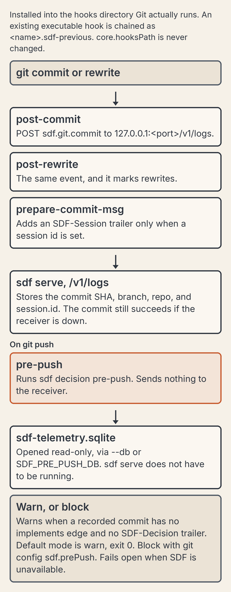

# Receiver

`./sdf serve` listens for OTLP/HTTP on `http://127.0.0.1:4318` and OTLP/gRPC on
`127.0.0.1:4317`, and writes `sdf-telemetry.sqlite` in the current directory.
4318 is the OTLP/HTTP default. 4317 is the OTLP/gRPC default, which is where
pi-otel exports unless you change it. Authentication is off by default; keep
the bind address on localhost. Override with `--host`, `--port` (HTTP),
`--grpc-port`, and `--db`. `--otlp-token`, `--otlp-token-file`, `SDF_OTLP_TOKEN`, or
`SDF_OTLP_TOKEN_FILE` is optional bearer authentication, described below.

[](diagrams/02-receiver.png)

Source: [02-receiver.tldr](diagrams/02-receiver.tldr) (open in [tldraw](https://www.tldraw.com); the official file extension is `.tldr`).

The HTTP receiver stores a body only for `Content-Type: application/json`
or `application/x-protobuf`. The type match is case-insensitive, and
parameters such as `charset` are allowed. Any other type, including a
missing `Content-Type`, `text/plain`, `multipart/form-data`, and
`application/x-www-form-urlencoded`, is HTTP 415 and is not written.
`POST /v1/sessions` accepts only `application/json` under that rule.
A request that includes an `Origin` header is HTTP 403 and is not written,
on every bind. Agent exporters, curl, and the git and session hooks do not
send `Origin`. A browser does, including a `no-cors` post of a
CORS-safelisted type, which is why the header is refused instead of
answered with CORS.

When the HTTP listener is bound to a loopback address, `Host` must be
`localhost`, `127.0.0.1`, or `[::1]`. The port may be omitted; a port that
is present has to be the bound port. Any other host is HTTP 403 and is not
written. That stops a page that rebinds its own name onto 127.0.0.1.
`--host` set to a non-loopback address does not apply this list. A remote
exporter sends whatever address it was given, and that bind is already an
exposure; `Origin` and the media-type check still apply. gRPC on 4317 is
unchanged. Browsers do not speak that protocol.

The same process serves a read-only UI at `http://127.0.0.1:4320/` unless
you pass `--no-ui`. `--ui-addr` moves the UI. `--host` does not: the page
stays on localhost when the receivers are bound wider. `--prices`, `--repo`,
`--github`, and `--budget` match `sdf summary` and apply to the page. `--budget`
names one local ceiling file; without it the page has no budget.

`GET /health` on the OTLP/HTTP port (`http://127.0.0.1:4318/health`)
returns `{"status":"ok"}`. The UI port does not serve it. HTTP exports are
`POST /v1/traces`, `POST /v1/metrics`, and `POST /v1/logs`. The body may use `Content-Length` or
`Transfer-Encoding: chunked`. OpenCode trace batches and pi-otel HTTP posts
are chunked and omit `Content-Length`. When both headers are present, chunked
encoding wins. `Content-Encoding: gzip` is inflated after the body is
framed, and the decompressed size is capped at the per-request body limit
(8,000,000 bytes unless `--max-body-bytes` says otherwise). At most one
non-identity coding is accepted. `identity, gzip` and `gzip, identity`
are that one gzip layer. A second gzip, or any other coding, is HTTP 415.
gRPC clients call the OTLP `TraceService`,
`MetricsService`, and `LogsService` `Export` RPCs, and may gzip the message.

### Resource limits

Each listener (OTLP/HTTP, OTLP/gRPC, and the UI) has its own connection
cap. The numbers below are the defaults. They are large enough for several
local agents and small enough that a client cannot open connections, or
hold request bytes, without bound. A flag overrides the matching
environment variable. Leaving both unset uses the default. `0` and a
negative value are rejected at startup; they do not turn the limit off.
A per-address or per-token cap higher than the connection cap is lowered
to the connection cap. The in-flight budget must be at least one maximum
body, so one accepted request always fits when nothing else is in flight.

| Limit | Flag | Environment | Default |
| --- | --- | --- | --- |
| Connections on one listener | `--max-conns` | `SDF_MAX_CONNS` | 128 |
| Connections from one address | `--max-conns-per-ip` | `SDF_MAX_CONNS_PER_IP` | 64 |
| Authenticated requests in flight | `--max-conns-per-token` | `SDF_MAX_CONNS_PER_TOKEN` | 64 |
| One request body, including after gzip | `--max-body-bytes` | `SDF_MAX_BODY_BYTES` | 8000000 |
| Bytes buffered at once | `--max-inflight-bytes` | `SDF_MAX_INFLIGHT_BYTES` | 67108864 |
| Time to send headers, or for a gRPC message to start | `--read-header-timeout` | `SDF_READ_HEADER_TIMEOUT` | 5s |
| Time to send an HTTP body or a gRPC message | `--read-timeout` | `SDF_READ_TIMEOUT` | 30s |
| Keep-alive idle time | `--idle-timeout` | `SDF_IDLE_TIMEOUT` | 90s |

Durations use Go's notation (`5s`, `1m30s`). The same connection numbers
and the three timeouts apply to the UI. The UI's write timeout stays 3
minutes so a `--github` refresh can finish. The byte caps apply to OTLP
bodies only.

An idle keep-alive connection counts toward the connection cap until it
closes or the idle timeout fires. The same connection also closes after
1000 requests or 10 minutes, whichever comes first. The per-token cap
counts authenticated requests that have not finished yet, and only when a
token is configured. `--max-conns-per-token` is that in-flight request
cap. It does not count idle connections. `GET /health` does not take a
token slot. When a token is set, a response that is not an authenticated
write (`GET /health`, a 404, a 401, a 403) sends `Connection: close`, so
an unauthenticated client cannot hold a slot by polling inside the idle
timeout. On loopback every connection is the same address, so the
per-address cap is the limit a local client can reach.

The per-address key is the full remote IP. An IPv6 client that changes
address inside one /64 is counted as a new address. The receiver does
not read `X-Forwarded-For`. Behind a reverse proxy every connection is
the proxy's address.

What is rejected, and with which status:

- A body larger than `--max-body-bytes`, including after gzip, is HTTP
  **413** with no `Retry-After`. The same payload will not succeed if it
  is retried. gRPC reports `RESOURCE_EXHAUSTED` with no retry hint, which
  OTLP treats as not retryable.
- The listener connection cap is HTTP **503** with `Retry-After: 1`.
  One address over its own cap is HTTP **429** with `Retry-After: 1`.
  Both are retryable. A gRPC connection past the cap is closed with no
  bytes written. The client sees a broken connection and retries.
- A forbidden Host or Origin (403) and a missing or wrong bearer token
  (401) are answered without reserving in-flight bytes and without
  allocating the `Content-Length`. The connection is closed.
- The in-flight byte cap, and the per-token request cap, are HTTP **503**
  (`inflight limit`) or **429** (`too many requests`), each with
  `Retry-After: 1`. On gRPC both are `RESOURCE_EXHAUSTED` with `RetryInfo`
  of one second, which is the retryable form of that code.
- Headers that do not finish in time, or a connection that sends nothing,
  are closed with no response. OTLP says a client retries when the server
  disconnects. A body that stalls after the headers is HTTP **503** with
  `Retry-After: 1`. A gRPC stream that has not sent a DATA frame within
  `--read-header-timeout` is `DEADLINE_EXCEEDED`, which is retryable, and
  it keeps its byte reservation until that deadline. Once a DATA frame
  has arrived, a message that has not fully arrived within
  `--read-timeout` is the same code. The call keeps its reservation until
  that deadline or until the message arrives. The first byte of a later
  HTTP request starts the header timer; until that byte, the idle timeout
  applies.

gRPC also caps streams on one connection (32), header metadata (1 MiB),
the HTTP/2 handshake (`--read-header-timeout`), and how long a connection
may live (idle from `--idle-timeout`, and 30 minutes even if it stays
busy). A client that pings more often than every 10 seconds is
disconnected. Pings with no active RPC are allowed. An admitted gRPC call
reserves `--max-body-bytes` from a gRPC share of the in-flight budget.
That share is half the budget, and always enough for one maximum body.
When `--max-inflight-bytes` equals `--max-body-bytes`, one body is the
whole budget, so the gRPC share is the whole budget and HTTP is not left
a separate remainder. A larger budget leaves HTTP the other half. The
reservation stays until the message has fully arrived. A stream that
has not sent a DATA frame within `--read-header-timeout` is cancelled
with `DEADLINE_EXCEEDED` and the reservation is released. A connection
may have two RPCs waiting for that first DATA frame; another is
`RESOURCE_EXHAUSTED` with `RetryInfo` of one second. After the first DATA
byte, `--read-timeout` is the deadline. The timer is stopped once the
message is in hand, before the SQLite commit, and the reservation
shrinks to the encoded size. A message larger than the body cap is
`RESOURCE_EXHAUSTED` with no retry hint. On shutdown, a commit that has
already started is given another 2 seconds to finish and write its
status before the remaining RPCs are closed.
HTTP reserves the `Content-Length` (or each chunk, and both the compressed
and the inflated bytes while gzip is expanding).

Bytes used after a payload has been decoded into records are outside this
budget. That limit is recorded in `dev-docs/gaps.md`.

None of these responses is a partial success. A stored export is answered
only after the SQLite commit, with HTTP 200 and `partial_success` left
unset (JSON `{}`, or an empty protobuf). A request that does not fit is
not queued and is not acknowledged early. On shutdown, gRPC is given
2 seconds to finish. A commit already in progress gets another 2 seconds
to write its status. Whatever is still open is then closed, so a
header-only stream cannot hold the process until the connection age.

Rows are one span, one metric point, or one log record. A span also stores
`status_code` (`UNSET`, `OK`, or `ERROR`) and `status_message`. Databases
written before those columns existed still open; the columns are added on
open, and a missing code is `UNSET`. Inspect them with SQLite:

```bash
sqlite3 sdf-telemetry.sqlite \
  "select signal, session_id, name from records order by id desc limit 20"
```

### WAL mode and backups

`sdf serve` opens the database in SQLite WAL mode with a 5-second busy
timeout, so `sdf summary` and other readers can run while the receiver
writes. `sdf summary` only reads: it opens the file read-only
(`mode=ro`, same busy timeout) and never creates it, applies the schema,
adds columns, or changes its journal mode. A missing `--db` file in an
existing directory reports an empty store and leaves no file behind; a
missing directory is an error. A rollback-journal database keeps its
journal mode and gets no sidecar files. Reading a WAL database needs its
`-shm` file; when the directory is writable SQLite creates `-shm` (and an
empty `-wal`) beside it, and a reader leaves them there. In a read-only
directory without `-shm`, `sdf summary` falls back to SQLite's
`immutable=1` read when there is no `-wal` file, since every committed
write is then in the main file. `immutable=1` takes no locks and assumes
nothing writes the file, so it is only a fallback after the normal
read-only open fails, never the first choice. If a `-wal` file is there,
it can hold writes the main file lacks, and `sdf summary` reports that
instead of reading stale data: make the directory writable, or open the
file once with `sdf serve` to checkpoint it. In WAL mode
SQLite keeps two
sidecar files next to the database, `sdf-telemetry.sqlite-wal` and
`sdf-telemetry.sqlite-shm`; recent writes may live only in the `-wal` file
until a checkpoint, so do not copy or delete the main file alone. Back up
with SQLite's online backup instead:

```bash
sqlite3 sdf-telemetry.sqlite ".backup sdf-telemetry.backup.sqlite"
```

WAL needs shared memory between processes on one host, so keep the
database on a local disk, not a network filesystem (NFS, SMB).

### Durability of ingested rows

The telemetry writer opened through `store.Open` sets `PRAGMA synchronous=NORMAL`
on its connection after the file is in WAL mode. `sdf serve`, `sdf decision add`,
`sdf decision link`, `sdf decision retract`, and the recall harness write
through that open. The pool is one connection. When it is replaced, the new
connection sets `NORMAL` again if that connection is in WAL mode. The pragma
is per connection. It is not stored in the file, and a reader (`sdf summary`,
any read-only open) keeps SQLite's default `FULL`. An in-memory store and a
file that stays in rollback-journal mode also keep `FULL`: outside WAL,
`NORMAL` can leave a database inconsistent after a power loss. The ledger is
a different file and stays at `synchronous=FULL`; see
[Journal mode](ledger.md#journal-mode-and-what-a-read-may-touch).

Under WAL, `NORMAL` does not fsync the WAL on every commit. SQLite still
syncs the WAL before a checkpoint and the database file after one. From
SQLite's synchronous rules:

- An application crash is safe. A transaction SQLite has committed is
  durable across a crash of sdf, in WAL mode, at any synchronous setting.
- A power loss or an operating-system crash can lose the most recently
  committed transactions. Those transactions can roll back the next time
  the file is opened. The database is not corrupted: WAL mode with
  `synchronous=NORMAL` stays consistent.

## Content storage

sdf drops content before anything is stored, for every agent, whatever the
agent's own settings say (`logPrompts`, `includeSensitiveSpanAttributes`,
`OTEL_LOG_*`, `OTEL_INSTRUMENTATION_GENAI_CAPTURE_CONTENT`,
`telemetry.traces`). Those settings decide what an agent sends; this
decides what sdf keeps. What is dropped (`record.Redact`):

- Attributes whose key names content, in record attributes, in nested maps
  and lists at any depth, and in the resource. Keys are compared
  case-insensitively: `prompt`, `request_text`, `response_text`,
  `tool_input`, `tool_output`, `tool_parameters`, `full_command`,
  `function_args`, `arguments`, `result`, `response`, `completion`,
  `messages`, `message`, `content`, `text`, `input`, `output`, `stdout`,
  `stderr`, `command`, `query`, `user_prompt`, `gen_ai.input.messages_ref`,
  `gen_ai.output.messages_ref`, `gen_ai.system_instructions_ref`, and any
  key equal to or under (`.`) one of `gen_ai.prompt`, `gen_ai.completion`,
  `gen_ai.choice`, `gen_ai.input.messages`, `gen_ai.output.messages`,
  `gen_ai.system_instructions`, `gen_ai.tool.call.arguments`,
  `gen_ai.tool.call.result`, `gen_ai.tool.definitions`, `llm.input_messages`,
  `llm.output_messages`, `llm.prompts`, `input.value`, `output.value`,
  `tool.input`, `tool.output`, and `ai` (the Vercel AI SDK spans opencode
  sends with `experimental.openTelemetry`: `ai.prompt`, `ai.response.text`,
  `ai.toolCall.args`, and the rest). So the indexed `gen_ai.prompt.0.content`
  goes too. Only text is dropped: a number or bool under one of these keys
  (a token count named `input`, `ai.usage.promptTokens`) is kept.
- Error text on logs and spans, at any depth: `error`, `error.message`,
  `error_message`, `errorMessage`, `error.stack`, `exception.message`,
  `exception.stacktrace`, `exception.stack`, `stack`, `stacktrace`.
- An error class, code, or finish reason (`error.type`, `error_type`,
  `exception.type`, `status_code`, `http.response.status_code`,
  `http.status_code`, `rpc.grpc.status_code`, `finish_reason`,
  `finish_reasons`, `gen_ai.response.finish_reasons`) is kept only while it
  is a short token (`^[A-Za-z0-9_.:/-]{1,64}$`, or a list of them); free
  text there is dropped.
- A log body other than an event name (`claude_code.api_request` stays;
  Gemini's "API response from ..." sentence goes). A log with no event name
  gets its body as its name, so that name goes with the body.
- A span status message. On an ERROR span sdf writes its own from the kept
  fields only: "hook error" on hook spans, "tool error" on tool spans (by
  the words of the span name in any case, such as `execute_tool bash`,
  `Tool.execute`, `tool_call`, `Qwen-Code.Hook`, or a tool name attribute),
  "error" elsewhere, followed by the error class and HTTP or gRPC code when
  they are kept: `tool error: FileNotFoundError`,
  `error: HTTP 429 Too Many Requests` (the reason phrase is Go's, not the
  sent text). On an OK or UNSET span the message is cleared. The status
  code stays, and the UI and `sdf summary` show `error_type` next to it.

What stays: names (span names included), ids, models, token counts, cost,
durations, success, token-shaped error classes and status codes, and
everything else the summary reads, so every summary, cost, and tool list
is the same as before. The size of each dropped text value is recorded as
`<key>_bytes` (`error_bytes`, `body_bytes`) and the dropped keys are listed
in `sdf.redacted`. A `git_commit_id` inside Claude Code's `tool_parameters`
is copied to `sdf.git_commit_id` first, so commit links still work. Span
events and metric exemplars are never stored. Content under a key sdf does
not know is stored; see [known gaps](https://github.com/paulpham157/sdf/blob/main/dev-docs/gaps.md).

To keep the text, opt in when starting the receiver:

```bash
sdf serve --store-content                      # every agent
sdf serve --store-content=claude-code,qwen     # only these agents
SDF_STORE_CONTENT=1 sdf serve                  # same as --store-content
SDF_STORE_CONTENT=qwen sdf serve               # a list works here too
```

Agent names are `claude-code` (`claude`), `codex`, `opencode`, `pi`,
`gemini-cli` (`gemini`), `qwen-code` (`qwen`), `grok-cli` (`grok`), and
`copilot-cli` (`copilot`); an unknown name is an error. The flag wins over
the variable, and `0`, `false`, or `off` turns it off. `sdf serve` prints a
line saying whose content it stores, and those rows carry
`sdf.content=kept`. The text then sits in the local SQLite file.

Rows written by an older sdf are not changed when the database is opened;
sdf never scrubs on its own. A new database is stamped (`PRAGMA
user_version = 1`) as written under these rules. A database that already
had rows and no stamp was written by an older sdf, and `sdf serve` prints
one warning line at start while that is so. To remove the text from it,
stop `sdf serve` on that file and run:

```bash
sdf redact --db sdf-telemetry.sqlite --dry-run   # count the rows that would change
sdf redact --db sdf-telemetry.sqlite
```

`sdf redact` applies the same rules to every stored row, including rows kept
with `--store-content` (their `sdf.content` mark goes too), including a log
name that is a copy of its body. It reads the rows in batches inside one
transaction (a crash leaves the file as it was), rewrites the rows that
changed with `secure_delete` on, runs `VACUUM` so the old text does not stay
in free pages, and stamps the file. `sdf serve` switches the telemetry database to WAL
mode; `sdf redact` checkpoints and truncates that WAL after `VACUUM` so the
old text does not remain in a sidecar file. A file still in rollback-journal
mode is handled too (the checkpoints are no-ops). It needs free disk of about
twice the file's size while it runs (the journal and `VACUUM`'s copy).
Running it again changes nothing.

- `--dry-run` opens the file read-only and writes nothing: no schema,
  migration, stamp, or lock file.
- The file must exist and have sdf's `records` table; any other file is
  refused.
- `sdf serve` holds `PATH.lock` (shared) while it runs, and `sdf redact`
  takes it exclusively, so redact refuses while a serve uses the file and
  a serve will not start while redact runs. An sdf older than this does
  not take the lock, so stop it by hand.
- The stamp only means the rows were written by an sdf with these rules
  (or scrubbed). An older sdf opened on a stamped file writes content into
  it with no warning; run `sdf redact` again after one has.
- Copies of the file elsewhere (backups, Time Machine, `.sdf-bak`) are not
  touched.

## Optional token authentication

`--otlp-token TOKEN`, `--otlp-token-file PATH`, `SDF_OTLP_TOKEN`, or
`SDF_OTLP_TOKEN_FILE` turns on a shared bearer token. The two flags are
mutually exclusive, as are the two environment variables. A flag beats the
environment. The token is read once at startup.

`--otlp-token` or `SDF_OTLP_TOKEN` with a blank value is the same as unset:
the receiver stays open, which is the default. A token file is trimmed of
leading and trailing whitespace. An empty or unreadable file is a startup
error; it does not disable authentication. On Unix, a group- or
world-readable token file prints a warning.

When a token is set, these requests must send `Authorization: Bearer <token>`:

- `POST /v1/traces`, `POST /v1/metrics`, `POST /v1/logs`, and `POST /v1/sessions`
- gRPC `TraceService`, `MetricsService`, and `LogsService` `Export` RPCs, as
  metadata key `authorization`

A missing or wrong token is HTTP 401 or gRPC `Unauthenticated`. The comparison
is constant-time. The token is not written to the request log. Without a
token, any local process can open gRPC streams. Each stream that has not
sent a message reserves a full body until `--read-header-timeout`, and one
connection may hold two of those reservations. That can fill the gRPC share
of the in-flight budget so other gRPC exports wait. Set a token: an
unauthenticated stream is rejected before it reserves bytes. `GET /health`
does not require the token, so `sdf init --check` still works. A valid token
does not bypass the media-type, `Origin`, or loopback `Host` checks above.
Those still return 415 or 403 and write nothing.

`sdf init --check` also posts an empty body with no `Content-Type` to
`/v1/logs`, sending the token the hooks would send (`SDF_OTLP_TOKEN`, else
the file named by `SDF_OTLP_TOKEN_FILE`; nothing when both are set, and,
as with the hooks, nothing to a host that is not loopback). The
token is checked before the media type, so a write that would pass gets 415
and nothing is stored. A 401 is reported as `token required` (no token set
here) or `token refused` (a different token), and `--check` exits 1. Any
other answer, including a redirect (which is not followed, so the token is
never sent on), is reported as `unexpected answer` and also exits 1.

Point an OpenTelemetry exporter at the receiver with:

```bash
export OTEL_EXPORTER_OTLP_HEADERS="Authorization=Bearer%20$SDF_OTLP_TOKEN"
```

The space after `Bearer` is written as `%20`, as the OpenTelemetry
specification requires for `OTEL_EXPORTER_OTLP_HEADERS`. The same header
works for HTTP and gRPC exporters that honor that variable. Agent-specific
settings are in [docs/agents.md](agents.md#optional-receiver-token).

### Hooks and the token

The session hooks (`sdf init claude-code`, `codex`, `grok`, `opencode`, and
`pi` with `--write`) and the git hooks (`sdf init --git-hooks`) read the
token when they run, from the same variables `sdf serve` reads:
`SDF_OTLP_TOKEN`, else the file named by `SDF_OTLP_TOKEN_FILE`, with
whitespace trimmed from the ends only, as `sdf serve` trims it (a space
inside the token is kept; CRLF line ends are fine). With both variables set
`sdf serve` refuses to start, so the hooks send no token and print
`sdf: SDF_OTLP_TOKEN and SDF_OTLP_TOKEN_FILE are both set` to stderr; a
blank `SDF_OTLP_TOKEN` counts as unset, as it does for `sdf serve`. With a token they add `Authorization: Bearer <token>`;
without one they post as before, so an open receiver needs nothing. The
token is never written into a hook file, a settings file, or a repository's
`.git/hooks`. curl gets the header on stdin (`-H @-`), and the git hook's
wget fallback gets it from a temporary wgetrc that is removed after the
post, and by a trap if the hook is interrupted or killed with SIGTERM (only
SIGKILL can leave it behind, in `$TMPDIR` with mode 0600), so the token is not on a command line. The JavaScript hooks (OpenCode,
Pi) read the same variables with `process.env` and `node:fs`.

The token is only sent to a loopback receiver (`localhost`, `127.0.0.0/8`,
or `::1`), because the hooks post plain HTTP. `sdf init AGENT --host`
with any other host writes session hooks that never read or send the token,
and `sdf init` says so; the git hooks post only to loopback in any case.
`sdf serve` refuses a non-loopback `Host`, so such a hook could not be
accepted anyway.

Checked live on 2026-11-23 with a signed-in `grok` 1.0.92 and a receiver
started with `--otlp-token-file`: with `SDF_OTLP_TOKEN_FILE` exported where
`grok` started, the Grok session hook's open and close, the git hook's
commit event, and Grok's logs, metrics, and internal spans (the last two with
the token in `OTEL_EXPORTER_OTLP_HEADERS` and `GROK_INTERNAL_OTLP_HEADERS`)
were all accepted, and the commit linked as `hook`. The same hooks without
the variable got 401 and stored nothing. The Claude Code hook was run by
hand the same way; under Grok (`GROK_HOOK_EVENT` set) it sent nothing.

A hook only sees the environment of the agent, or of `git`, that runs it.
One way to share the token with `sdf serve`:

```bash
umask 077; mkdir -p ~/.config/sdf
head -c 32 /dev/urandom | base64 > ~/.config/sdf/otlp-token
# in the shell profile, so sdf serve, the agents, and git all see it
export SDF_OTLP_TOKEN_FILE=~/.config/sdf/otlp-token
sdf serve
```

`sdf init --write` still does not add the exporter header to an agent's
telemetry settings; set `OTEL_EXPORTER_OTLP_HEADERS` (or the agent's own
setting) as described in [docs/agents.md](agents.md#optional-receiver-token).

A token only detects callers that do not have it. `--otlp-token-file`
keeps the token out of the process listing, but a world-readable file, a
settings file, or an agent log can still expose it. Keep the bind address
on localhost unless you trust the network.

## The UI

The process prints `UI listening on http://127.0.0.1:4320/` (the default).
Open that URL on the same machine.

The UI checks `Host` before every route, including the HTML, the
stylesheets (`/tokens.css` and `/app.css`), the script, and the favicons.
`localhost`, `127.0.0.1`, and `[::1]` are allowed. A non-loopback
`--ui-addr` also allows that configured host. The port may be omitted; if
it is present it has to be the bound port. Anything else is HTTP 403 and
the handler does not run, so a rebound name cannot read `/api/summary` or
trigger the `--github` lookups. The listener limits header reads to 5s,
request reads to 30s, writes (including a GitHub lookup) to 3 minutes, and
idle connections to 90s.

The page has three views. Overview is the total across sessions and the cost
per accepted outcome, including that figure per agent, plus charts of
decision-link recall over time, unlinked commits and unlinked decisions
(the same gaps `sdf decision audit` reports), and sessions and computed
cost by UTC day. The charts are inline SVG with a data table under each
plot, and they are omitted when the store has no commits, decisions, or
dated sessions. Sessions lists every
stored session, newest first, with the agent, start time, duration, models,
input and output tokens, computed cost, the cost the agent reported, the
linked commit or pull request, and whether the link was exact, hook, trailer,
heuristic, or none. Filter the list by agent, or click a column to sort it. A session
opens onto the totals, the token buckets, a per-model note, tool-call counts,
the two costs side by side, and the outcome. A field the summary could not
establish says `unknown` and gives the reason (no published price, no working
directory or commit, merge status not requested).

Those numbers are the `sdf summary` report. The decision records and the budget are drawn on every view, the overview, the session list, and the session detail, and both are drawn even when the store has no sessions. The page does not price tokens
again. `GET /api/summary` on the UI port is the same document as
`sdf summary --json` for that database, including `--prices` and `--repo`.
The process keeps that summary for the current records snapshot and price
catalog. A repeat request does not read the records table again. The
snapshot is a generation counter, bumped once per insert and once per
content scrub that rewrites a row, together with the greatest record id.
The next request after an insert or a scrub reads the table and computes
the summary again. The bytes match that full computation. Git outcomes
and GitHub merge status are attached on every request, so a new commit
or a changed pull request shows up without a new telemetry row. One
report is kept, and it is replaced when the snapshot or the catalog
changes.
`GET /api/snapshot` is that report newest-first, plus the per-agent totals
and `activity_by_day` (session counts and computed cost by the UTC day
the session started; sessions with no start time are `undated_sessions`,
not a day). `GET /api/decisions` reads the decision records. It is empty when none have
been recorded, and recording one does not change the summary.
`GET /api/overview-charts` is the decision-link recall and unlinked-gap
series for the overview charts, reusing `sdf decision audit` on a
read-only connection so a long read does not hold the writer's mutex
(issue #272). Recall is the share of SDF-recorded commits that have an
`implements` edge to a stored decision. `SDF-Decision` trailers are not
in the store, so they are not counted (issue #281). Days are UTC
calendar dates; a quiet day between the first and last event is included
with zeros, and a day with no commits omits daily recall rather than
calling it zero. All four routes are
read-only. There is no route that writes or deletes. A response that cannot
be encoded is `500` with a JSON error, not an empty `200` (issue #267).

A known `0` is a published price of zero, such as a `:free` model whose
token buckets are all priced. It is not a stand-in for a missing price,
with one exception (issue #243). On an OpenRouter row whose id ends in
`:free` and whose prompt and completion are both `0`, cache-read tokens are
priced at `0` when the row has no `input_cache_read` price. The cost `note`
says so. See [summary.md](summary.md). If
any session in a total has an unknown computed cost, the total is unknown
too. The summary does not split one session's tokens across several models,
so the page does not either: several models stay unknown, with the session
total still shown as a session total.

`--github` asks whether a linked commit's pull request merged, on each
refresh, the same way `sdf summary --github` does. Without it, accepted
stays unknown because merge status was not requested. The cost per accepted
outcome uses that answer. It is unknown, not zero, when nothing merged or
when a session has no known outcome.

The UI is on by default, so `sdf serve` and a browser are all it takes.
`--no-ui` leaves the OTLP ports only. It is a second listener, embedded in
the sdf binary (HTML, CSS, and script). The page does not load fonts,
scripts, or anything else from the network.

`sdf serve --host 0.0.0.0` exposes the OTLP receivers on every interface.
Those payloads can include prompts and filesystem paths when the agent is
opted in. A bearer token is a shared secret, not a substitute for a trusted
network. On that bind the HTTP receiver still rejects an `Origin` and a
non-OTLP media type. It does not filter `Host`, because a remote exporter's
`Host` is the address it was given. The UI still binds to `127.0.0.1` in
that case. `--ui-addr 0.0.0.0:4320` listens on every interface and prints a
warning. Requests are still limited to `Host` `0.0.0.0`, `localhost`,
`127.0.0.1`, or `[::1]`, so a browser that opens the machine's LAN address
is refused until `--ui-addr` names that address. The Host check is not
authentication: anyone who can open the socket can send an allowed name.
Do not bind the UI on a network you do not trust.

An empty database shows an empty state that points at `sdf init`.

## One-step setup

`sdf init` prints the exporter settings for one agent. It does not change a
file unless you pass `--write`. An existing file is copied to a sibling
ending in `.sdf-bak` before it is changed (an older `.sdf-bak` is kept, and
the new copy gets a timestamped name). The new bytes are written to a temp
file and renamed into place, keeping the file mode. A read-only file is
refused and left alone. A symlink is written through; a link to a file
that does not exist yet creates it, but sdf creates missing directories for
it only inside the agent's config directory or `$HOME` (a link to
`/elsewhere/missing/config.toml` is refused). A symlink loop is refused
with a message saying so. Without `--write`, the JSON agents print only the
keys sdf would set, not the rest of the file. A file that is not valid JSON is
left untouched. An existing Codex `[otel]` table is left untouched.

```bash
sdf init claude-code
sdf init claude-code --write
sdf init codex --write
sdf init qwen --write
sdf init opencode --write
sdf init copilot --write
sdf init pi --write
sdf init pi --write --global
sdf init pi --install
sdf init grok
sdf init grok --write
sdf init gemini --write
sdf init --git-template --set-template-dir
sdf init --check
```

`--check` GETs `http://127.0.0.1:4318/health` and opens a TCP connection to
`127.0.0.1:4317`. The TCP connect does not speak gRPC. Either listener
counts as reachable. `--host`, `--port`, and `--grpc-port` match `sdf serve`.
`--host` must be a host name (a fully qualified name may end in one dot,
`example.com.`; `localhost.` is written as `localhost`), a dotted-decimal
IPv4 address (short, hex, and octal forms such as `127.1`, `0x7f.0.0.1`, or
`0177.0.0.1` are refused), or an IPv6 address (bare or in brackets). The
unspecified address is refused in every spelling (`0.0.0.0`, `::`,
`::ffff:0.0.0.0`, `::ffff:0:0`, `::0.0.0.0`): `sdf serve` can bind it, but an
agent cannot send to it, so the error suggests `--host 127.0.0.1` (or `::1`,
or this machine's address). The ports must be plain decimal 1-65535
(`--port 0`, `08`, and `+4318` are refused); anything else is refused, with
exit code 2, before `--check` probes anything or a file is written.
`--host 127.0.0.1:4318` (or `127.0.0.1:`, `[::1]:4318`,
`::ffff:127.0.0.1:4318`) is refused with a hint you can paste, such as
`pass --host 127.0.0.1 --port 4318`. The hint only names a host and port
init accepts: an unspecified host becomes `127.0.0.1`, an IPv4 address
written as IPv6 becomes the IPv4 address, a host that is refused on its own
(`[::%lo]:4318`, `127.1:4318`) is said to be refused, and a port outside
1-65535 (`0`, `00`, `65536`) is not echoed. A bare IPv6 address whose last
group reads as a port (`fe80::1:4318`) is refused with both readings; write
it in brackets (`[fe80::1:4318]`) to mean the address. When the bracketed
reading is refused too (`[::1:4318]` is `::0.1.67.24`), only the port
reading is offered. An IPv4 address written as IPv6 (`::ffff:127.0.0.1`, or
the deprecated `::127.0.0.1`) is refused with a hint to pass the IPv4
address, or `::1` for IPv6 loopback. `--git-hooks` takes
`::1` with or without brackets. Those values end up in files other programs run
(`opencode.env` is sourced by a shell, the Claude Code and Codex session
hooks are shell commands), and the URL is single-quoted in both.

`sdf init qwen` (alias `qwen-code`) merges `enabled: true`, `otlpEndpoint`
(the HTTP receiver), `otlpProtocol: "http"`, and `logPrompts: false` into
the `telemetry` object of `$QWEN_HOME/settings.json` or
`~/.qwen/settings.json`. Qwen Code's own default for `logPrompts` is true,
so sdf turns it off even when the file says `true`, and warns. It does the
same for `includeSensitiveSpanAttributes`. A workspace or system file can
still turn them back on (see below); the receiver drops that content before
storing anything, whatever the settings ([content storage](#content-storage)). Key order, indentation, a UTF-8
BOM, big integers, and `&`, `<`, `>` in strings are kept; other keys are not
touched. The dry run prints only the telemetry keys sdf manages, not the
rest of the file or other telemetry keys, which may hold secrets (MCP
server env, `otlpHeaders`). A file with comments (Qwen Code accepts them)
or that is not a JSON object is left untouched, and so is an existing empty
file (Qwen Code cannot load one either; put `{}` in it), and the `QWEN_TELEMETRY_*`
variables are printed instead; with `--write` that is an error (non-zero
exit). `telemetry.outfile`
and per-signal `otlp*Endpoint` keys are kept and reported, because they
override the endpoint. The write runs the same precheck as the other
agents: it refuses a file with no write bit (0400, 0444, 0000, even as
root), a file the user cannot write, an unwritable directory, and, as root,
a symlink that resolves outside the settings directory and `$HOME` (for
anyone else that link is written through with a warning). It
goes through a temp file in the same directory (fsync, rename), keeps the
mode and, where the process may, the owner. The rename gives the file a new
inode, so a hard link keeps the old content and extended attributes or ACLs
are not copied. A symlink is followed with `readlink`. It must end at a
`.json` file, compared exactly (a link to `~/.bashrc` or `Settings.JSON` is refused). A link to a file that does
not exist yet (stow-style) creates it: inside the settings directory,
missing parent directories are created with mode 0700; outside it, only
when the target's directory already exists, so sdf never creates
directories elsewhere. The old file is copied
to `.sdf-bak`; a different existing backup is kept and `.sdf-bak.1`, ... is
used, and a backup made by a failed write is removed.

What wins, from Qwen Code's `resolveTelemetrySettings` and `mergeSettings`:
CLI flags (`--telemetry`, `--telemetry-otlp-endpoint`,
`--telemetry-otlp-protocol`, `--telemetry-log-prompts`,
`--telemetry-outfile`), then `QWEN_TELEMETRY_*` (and
`OTEL_EXPORTER_OTLP_ENDPOINT` for the endpoint; `QWEN_TELEMETRY_OTLP_*` and
`OTEL_EXPORTER_OTLP_*` per-signal endpoints), then the merged settings:
system (`/etc/qwen-code/settings.json`, or `QWEN_CODE_SYSTEM_SETTINGS_PATH`)
over the workspace `<cwd>/.qwen/settings.json` over the user file over
system defaults (`system-defaults.json` beside the system file, or
`QWEN_CODE_SYSTEM_DEFAULTS_PATH`). The workspace file is ignored when
`security.folderTrust.enabled` is true and the folder is not trusted (folder
trust is off by default). `sdf init --check qwen` reads every layer, shows
which one sets each key, applies the environment, says whether Qwen Code
points at this receiver over HTTP, and warns when `logPrompts` is on.
There is no session hook for Qwen Code, so its window is inferred from the
records.

`sdf init grok` (alias `grok-cli`) prints the Grok CLI variables as `export`
lines, the receiver-token header, and the same settings as a `[telemetry]`
table: `otel_enabled = true`, `otel_metrics_exporter = "otlp"`,
`otel_logs_exporter = "otlp"`, `otel_protocol = "http/protobuf"`, and
`otel_endpoint` (the HTTP receiver), plus the four content gates pinned
off: `otel_log_user_prompts`, `otel_log_assistant_responses`,
`otel_log_tool_details`, and `otel_log_tool_content` all `= false` (an
`OTEL_LOG_*` environment variable still wins). Pinning
`otel_log_tool_details` off is stricter than the guide's "Recommended fleet
gates", which turns that metadata gate on for SIEM joins; sdf does not need
it for Grok. `--write` appends that table to
`$GROK_HOME/config.toml` (default `~/.grok/config.toml`) when the file has
no `[telemetry]` table, and writes `hooks/sdf-session.json` in that
directory. Both files are checked before either is written, as for the
other agents, so a read-only `config.toml` or an unwritable `hooks/`
directory leaves both unchanged, with no `.sdf-bak`. An existing
`[telemetry]` table is left unchanged; add the printed keys to it by hand.
The file is parsed as TOML, so a `[ telemetry ]` header with spaces, an
inline `telemetry = {...}`, dotted `telemetry.x = ...` keys, and a quoted
`"telemetry"` key all count as an existing table (appending a second one
would make Grok fail to parse the file). A `config.toml` that is not valid
TOML is refused and left unchanged. A project `.grok/config.toml` cannot set
`otel_*`. Grok reads the environment over the file, so an
`OTEL_EXPORTER_OTLP_ENDPOINT` exported for another tool also redirects Grok.
`OTEL_LOG_USER_PROMPTS`, `OTEL_LOG_ASSISTANT_RESPONSES`,
`OTEL_LOG_TOOL_DETAILS`, and `OTEL_LOG_TOOL_CONTENT` set in the shell that
runs `sdf init` are reported when Grok would read them as on (`1`, `true`,
`yes`, or `on`, any case, as Grok's `env_bool` parses them; `0`, `false`,
`no`, `off`, and unknown values leave the file's `false` in effect), because
each one overrides the pinned key. Three put content on the stream;
`OTEL_LOG_TOOL_DETAILS` is a metadata gate (a 4 KB `tool_parameters`
preview, full file paths, verbatim MCP/skill/plugin names, no bodies).
Grok's own defaults for all four are off. Grok has no config-file key for headers; a receiver token goes in
`OTEL_EXPORTER_OTLP_HEADERS` (see
[docs/agents.md](agents.md#optional-receiver-token)). The keys and paths are
from grok-build `user-guide/24-monitoring-usage.md` ("Config file"),
`xai-grok-telemetry/src/config.rs` (`TelemetryConfig`), and
`xai-dirs/src/lib.rs` (`GROK_HOME`) at grok-build `2bdd1d6`, read
2026-11-23.

`--write` also installs a session hook for that agent. The hook posts to
`POST /v1/sessions` when a session opens and, where the agent has such an
event, when it closes. The collector stores each as a log named
`sdf.session.open` or `sdf.session.close` and uses those as the session's
window instead of inferring one from the records. A session with no close
stays open. An agent with no hook keeps the inferred window. For Claude Code
(`~/.claude/settings.json`) and Codex (`hooks.json`), sdf adds its hook to the
`SessionStart` and `SessionEnd` arrays and keeps every other entry, matcher,
and event; an sdf hook already there, including one an older sdf wrote with
another host or port, is updated in place, so a rerun changes nothing. Only
the exact command text an sdf build has written counts as sdf's hook; a user's
own hook that also posts to `/v1/sessions` is never rewritten. An event whose
value is not an array, `null` included, is refused and the file is left as it
was. The hook exits
without effect when the collector is not running, so it never blocks the
agent. Codex posts only for the root thread, because a descendant's hook
reports the shared session id while its spans carry the thread id. OpenCode
has no close event, so only the open is posted. Pi reads the session id from
the session manager rather than from the file name pi-otel exports. Grok
posts both edges and reads `GROK_SESSION_ID`, then `sessionId`.

For Claude Code and Codex, `--write` also appends a SessionStart hook that
runs `sdf decision brief` with no flags, a 2 second timeout, and fail-open
exit, so the agent can read the brief on stdout at session start. The hook
reads `sdf-telemetry.sqlite` in the session working directory (there is no
environment variable); start the session from the directory that holds the
store, or the hook injects nothing. Other agents do not get that hook; run
the command or use the skill. See
[Decisions at session start](agents.md#decisions-at-session-start).

GitHub Copilot CLI is configured by environment only (see
[docs/agents.md](agents.md#github-copilot-cli)); it reads no settings-file
key for the endpoint. `sdf init copilot` (alias `copilot-cli`) prints the
lines of `~/.config/sdf/copilot.env` that sdf manages (never your other
lines, which can hold tokens; it says how many it keeps):
`OTEL_EXPORTER_OTLP_ENDPOINT` (the HTTP receiver),
`OTEL_EXPORTER_OTLP_PROTOCOL=http/json`, and
`OTEL_INSTRUMENTATION_GENAI_CAPTURE_CONTENT=NO_CONTENT`, each value in
single quotes. `--host` must be a host name, an IPv4 address, or an IPv6
address (bracketed or bare) and `--port` must be 1-65535, so nothing in the
file can run when it is sourced. Copilot does not load the file; run
copilot through `sh` so the variables do not stay in your shell (this also
works from fish, which has no POSIX subshell):
`sh -c '. "$1" && exec copilot' sh ~/.config/sdf/copilot.env`. `--write`
merges in place: line order and unrelated lines are kept, the endpoint and
protocol lines are replaced (with a warning when the old value differed),
and a capture-content line you already set is kept, with a warning when it
puts content on spans (`SPAN_ONLY`, `SPAN_AND_EVENT`). That setting decides
what Copilot CLI sends; sdf still drops the content before storing it unless
`sdf serve --store-content` is on ([content storage](#content-storage)). The write goes to a temp file in the same directory,
is fsynced, keeps the file mode (and the owner and group when the process
may set them), and is renamed into place. Because the file is replaced,
other hard links keep the old contents (a note is printed) and extended
attributes and ACLs are not copied. A file that exists but that sdf may not
write, or that has no write bit (`0400`, even for root), is refused before
anything else. A symlinked file is written through to its target; a link
to a file that does not exist yet (stow-style, relative links read from the
link's directory) creates that file, and creates its missing parent
directories with mode 0700. The write uses the same helper as the other
agents: the old file is copied to a `.sdf-bak` sibling of the path sdf was
given (next to the link, for a symlink); an existing `.sdf-bak` is never
overwritten (the copy goes to `.sdf-bak.<UTC timestamp>` instead), and a
backup made by a failed write is removed. A link that leads outside its
directory and `$HOME` gets a warning, and is refused when sdf runs as root.

What wins: the environment of the `copilot` process. Per-signal variables
(`OTEL_EXPORTER_OTLP_TRACES_ENDPOINT`, `OTEL_EXPORTER_OTLP_METRICS_ENDPOINT`,
and the `_PROTOCOL` pair) override the generic ones, and
`COPILOT_OTEL_EXPORTER_TYPE=file` or `COPILOT_OTEL_FILE_EXPORTER_PATH` sends
export to a file instead. Any OTLP certificate or client key variable makes
Copilot drop an `http://` endpoint. Organization or device managed settings
can also configure export; sdf cannot read them. `sdf init copilot` and
`sdf init --check copilot` warn about each of these that is set in the
current environment or the snippet, and `--check` reports whether the
process environment and the snippet point at this receiver. There is no
session hook for Copilot CLI, so its window is inferred from the records.

For Grok CLI, `--write` writes `$GROK_HOME/hooks/sdf-session.json` (default
`~/.grok/hooks/`). sdf owns that file: a different one is replaced and the
old one copied to `.sdf-bak`. Grok loads every `*.json` in that directory
as a user hook file, which is trusted (a project `.grok/hooks/` file is not,
until that folder is trusted), in the same
`{"hooks": {"SessionStart": [...]}}` shape. The hook reads the session id
from `GROK_SESSION_ID`, which Grok sets on every hook process
(`xai-grok-hooks/src/runner/command.rs`), then from `sessionId` or its
snake_case alias `session_id` on stdin. Stdin also carries `source` on
`SessionStart` and `reason` on `SessionEnd`. `SessionStart` does not fire for a subagent's
own session, and a child's `SessionEnd` carries `subagentType`, so the hook
posts nothing for it. The hook also sends the working directory as `cwd`:
the envelope's `workspaceRoot`, which Grok sets to the git toplevel of the
session directory (or that directory outside a checkout), else its `cwd`
(`xai-grok-shell/src/session/acp_session_impl/spawn.rs`,
`find_git_root_from_path(session_info.cwd)`; `session/acp_session/hooks.rs`,
`make_hook_envelope`). The value is passed on as the escaped JSON string it
already is, so spaces, quotes, and backslashes in the path survive. The
collector stores it as `sdf.session.cwd` on the open and close logs (one
line, at most 4096 bytes; anything else is a 400), and the summary uses it
as the session's working directory (see
[docs/outcomes.md](outcomes.md#linking-a-session-to-a-commit)). Only the
Grok hook sends `cwd`; the other agents' hooks are unchanged. Grok
substitutes `$VAR` in a hook command from its own
environment when it loads the file, and refuses a command with a `$VAR` it
cannot resolve unless the command assigns it; the sdf command uses
`sdf_`-prefixed local names, `${PATH:-}`, `${GROK_SESSION_ID:-}`,
`${SDF_OTLP_TOKEN:-}`, and `${SDF_OTLP_TOKEN_FILE:-}` for that reason. `SessionEnd`
hooks get 1.5 seconds by default, so the post uses `curl -m 1`. Sources:
grok-build `user-guide/10-hooks.md` ("Hook Locations", "Hook Events"),
`docs/custom-hooks.md` ("Variable Substitution"), and
`xai-grok-hooks/src/event.rs` (`HookEventEnvelope`, `HookPayload`) at
`2bdd1d6`, read 2026-11-23. Checked live with `grok` 1.0.92 on 2026-11-23
(see [docs/agents.md](agents.md#grok-cli)).

Grok also runs the hooks in `~/.claude/settings.json` by default (Claude
Code compatibility). The Claude Code hook sdf writes therefore starts with
`[ -z "${GROK_HOOK_EVENT:-}" ] || exit 0`: Grok sets `GROK_HOOK_EVENT` on
every hook process, Claude Code does not, and without the check a Grok
session would also post a `claude-code` open and close. Rerunning
`sdf init claude-code --write` updates an older sdf hook in place.

The settings are the ones in [docs/agents.md](agents.md). Claude Code's variables are
from the [monitoring doc](https://code.claude.com/docs/en/monitoring-usage)
and are written to `~/.claude/settings.json`, not to a repository settings
file. Codex's `[otel]` table is from the
[config reference](https://developers.openai.com/codex/config-reference) and
is written to `$CODEX_HOME/config.toml`. OpenCode v2 only needs
`OTEL_EXPORTER_OTLP_ENDPOINT`; `--write` saves a snippet you source, because
OpenCode does not load that file itself. Pi needs `pi install npm:pi-otel`
(the extension checked here is 0.3.0). `--install` is what runs that command.
`--write` updates `.pi/settings.json` in the current directory. `--write
--global` updates `~/.pi/agent/settings.json` instead and leaves the project
file alone. pi-otel 0.3.0 reads the project file first, then the global file.
Environment overrides both. Either write copies an existing file to a
`.sdf-bak` sibling and leaves a file that is not valid JSON untouched. The
protocol in that file is `http/json`. pi-otel's own default is gRPC on port
4317, which this receiver also accepts. `sdf init --check pi` reports whether
the process environment, the project file, and the global file point at this
receiver.

Gemini CLI's settings are from its
[telemetry doc](https://github.com/google-gemini/gemini-cli/blob/main/docs/cli/telemetry.md).
`sdf init gemini --write` (alias `gemini-cli`) merges `enabled: true`,
`target: "local"`, `otlpEndpoint` (the HTTP receiver), and
`otlpProtocol: "http"` into the `telemetry` object of
`~/.gemini/settings.json`. Other keys keep their values and their order, and
the keys it adds go after them. Numbers keep every digit and `&`, `<`, `>`
are not escaped. The file is re-indented (with the indentation of its first
indented line) and an unneeded `\u` escape becomes the plain character. It
sets `logPrompts: false` only when the file does not already set
`logPrompts`; Gemini CLI's own default is `true`, and an existing
`logPrompts: true` is kept with a warning. Replacing an existing `target`,
`otlpEndpoint`, or `otlpProtocol` prints the old and new value. Without
`--write` it prints the `telemetry` keys sdf manages as they would be
written, and the same warnings. It never prints the rest of the file
(`mcpServers` env, `otlpHeaders`, and the like can hold secrets); it only says
how many other top-level keys are kept.

An existing file is copied to a `.sdf-bak` sibling first. A backup that is
already there is never overwritten: the copy goes to
`.sdf-bak.<UTC timestamp>` instead (with `-2`, `-3` if that is taken too).
The new bytes go to a temp file in the same directory, which is synced and
then renamed over the old file, so a crash leaves either the old or the new
file. The file mode is kept, and so are its owner and group when the process
may set them (as root, or for a group you belong to); otherwise the new file
belongs to you. Because the file is replaced, not rewritten in place, other
hard links to it keep the old contents (sdf prints a note when the file had
more than one link), and extended attributes and ACLs are not copied. When
`settings.json` is a symlink, sdf writes through it: the link stays and its
target is replaced, and the backup sits next to the link. A link to a file
that does not exist yet (a stow-style dotfile) creates that file, with a
relative link read from the link's directory. A file that exists but that
sdf may not write, or that has no write bit at all (`0400`, `0444`, even for
root), is refused before any backup or write. sdf also checks that it can
create files in the directories the write uses (it creates and removes a
probe file there): the target's directory, the link's directory for the
backup, and, for a file that does not exist yet, the nearest existing parent
directory. A `0555` directory is refused with its mode in the message. A
symlink that resolves outside its own directory and `$HOME` is written
through with a warning; as root it is refused. If the write fails, the temp
file and the backup it just made are removed. The same checks, backup, and
atomic write apply to every file `sdf init --write` changes, the Codex
`config.toml` included. When one agent needs two files (Codex `config.toml`
and `hooks.json`, Pi settings and its extension, OpenCode's env file and
plugin), both are checked before either is written. The check runs before
the write, not under a lock: if another process changes a mode, directory,
or link in between, that write fails without changing its file, but a file
already written by the same init stays written.

A file that is not plain JSON (Gemini CLI also accepts comments) is left
untouched, and the printed `GEMINI_TELEMETRY_*` variables can be used
instead. A `telemetry.outfile` already in the file wins over the endpoint in
Gemini CLI, so it is reported, not removed.

Gemini CLI layers its settings files: the user file, then a workspace
`.gemini/settings.json` (only when the folder is trusted), then the system
file `/etc/gemini-cli/settings.json` (or `GEMINI_CLI_SYSTEM_SETTINGS_PATH`),
which wins over both. `GEMINI_TELEMETRY_*` overrides every file, and
`OTEL_EXPORTER_OTLP_ENDPOINT` overrides `telemetry.otlpEndpoint` when
`GEMINI_TELEMETRY_OTLP_ENDPOINT` is unset. There is no session hook for
Gemini CLI yet, so its window is inferred from the records.
`sdf init --check gemini` reports whether `GEMINI_TELEMETRY_OTLP_ENDPOINT` or
the user settings file point at this receiver. It warns when
`OTEL_EXPORTER_OTLP_ENDPOINT` points elsewhere (and
`GEMINI_TELEMETRY_OTLP_ENDPOINT` is unset), when the system file sets
telemetry that would keep records from sdf (`enabled: false`, another
`target`, `otlpEndpoint`, or `otlpProtocol`, or an `outfile`), and when the
current directory's `.gemini/settings.json` does, noting it applies only in a
trusted folder.

## Git hooks

[](diagrams/10-git-hooks.png)

Source: [10-git-hooks.tldr](diagrams/10-git-hooks.tldr) (open in [tldraw](https://www.tldraw.com); the official file extension is `.tldr`).

Pi, OpenCode, Codex, Grok CLI, and Qwen Code do not export a commit SHA, and
Claude Code exports one only with `OTEL_LOG_TOOL_DETAILS=1`. `sdf init --git-hooks`
installs `post-commit`, `post-rewrite`, `prepare-commit-msg`, and `pre-push`
(the [pre-push decision check](#pre-push-decision-check)) into the
hooks directory Git actually runs (`git rev-parse --git-path hooks`). On
Git 2.43 that directory is shared by linked worktrees, so one install covers
them. The event records the toplevel of the worktree that committed.

Run `sdf serve` first. In the checkout the agent will commit in:

```bash
sdf init --git-hooks --db /path/to/sdf-telemetry.sqlite
```

`--host`, `--port` match `sdf serve`. `--db` is the store `sdf serve`
writes (the path it prints after `db=`); only the pre-push check reads it. The hook posts only to
`http://127.0.0.1:<port>/v1/logs` (or `[::1]`). Any other host is rejected.
`http_proxy` is ignored. Re-running with the same port leaves an existing
install in place. `sdf init --uninstall-git-hooks` removes the sdf scripts
and puts back a hook they had chained.

An existing hook is not overwritten. An executable script is renamed to
`<name>.sdf-previous` and run first. A symlink, or a file that is not
executable, is left untouched and the command fails. `core.hooksPath` is
never changed. If it already points at husky, lefthook, or pre-commit, sdf
writes chain scripts under the common git dir's `sdf-hooks/` and prints the
lines to add. It does not edit those tools' files.

```bash
# husky: add to .husky/post-commit and .husky/post-rewrite
# Put these lines before any exit 0, or at the top of the file.
sh /path/to/.git/sdf-hooks/post-commit
# and to .husky/prepare-commit-msg
sh /path/to/.git/sdf-hooks/prepare-commit-msg "$@"
# and to .husky/pre-push (the script reads git's ref lines on stdin)
sh /path/to/.git/sdf-hooks/pre-push "$@"
```

Put each line before any `exit 0`, or at the top of the file. Lines after
`exit 0` never run, and the commit still succeeds. Lefthook gets the same
commands in `lefthook.yml`. pre-commit does not run `post-commit` unless you
add a hook that calls the script. A shell script that lefthook or pre-commit
calls has the same rule: the sdf line has to run before any `exit 0`. If
`.husky`, `lefthook.yml`, or `.pre-commit-config.yaml` is present but
`core.hooksPath` is unset, Git is not using them yet; the install says so.

`sdf init --git-hooks` changes one repository. To give every future clone and
`git init` the same hooks, install them into Git's template directory:

```bash
sdf init --git-template --set-template-dir
```

`--set-template-dir` creates `~/.config/sdf/git-template`, copies Git's
default template into it when the directory is empty (so new repositories
still get the stock sample hooks and `info/exclude`), installs the sdf hooks
there, and runs `git config --global init.templateDir` to that path. The
command prints the previous value, which is unset the first time.
`sdf init --git-template` alone does not change git config.

If `init.templateDir` is already set, `sdf init --git-template` installs into
that directory and does not change git config, including when
`--set-template-dir` is also passed. `GIT_TEMPLATE_DIR`, when set, is the
directory Git actually uses and overrides `init.templateDir`. The command
installs there and does not write git config. An existing hook is chained or
refused the same way as in a repository. A template you already have is not
replaced.

```bash
sdf init --uninstall-git-template
sdf init --uninstall-git-template --unset-template-dir
```

Uninstall removes the sdf hooks from the template directory in use.
`--unset-template-dir` unsets `init.templateDir` only when that value is
`~/.config/sdf/git-template`, and it prints the previous value. A template
you configured yourself is left in git config. The directory is left on disk.

Existing repositories are unchanged. Run `sdf init --git-hooks` in each one,
or re-run `git init` there. `git init` copies template hooks that are missing
and does not replace a hook that already exists. A new clone, and `git init`
of a new directory, pick the template up. `GIT_TEMPLATE_DIR` still overrides
the config value.

The hook is POSIX `sh`. It uses `curl` when that is on `PATH`, otherwise
`wget`. A missing client, a refused connection, or a slow receiver does not
fail the commit (`--connect-timeout 1 --max-time 1`). The POST body is an
OTLP log named `sdf.git.commit` with the commit SHA, the checkout toplevel,
the branch name, the agent session id, and any `SDF-Decision` trailer
values. It does not include the subject, the body, other trailers, or the
diff. Trailer values are read with
`git log --format=%(trailers:key=SDF-Decision,valueonly)` (the same form
pre-push uses), never `git interpret-trailers --parse`, which would emit
every trailer including `Signed-off-by`. A malformed id is dropped, is not
sent, and does not fail the commit. `sdf summary` reads the subject from
the local git object after the link, the same way it does for a SHA the
agent exported.

When `sdf serve` receives that event, it appends a `commit implements
decision` edge for each valid `SDF-Decision` id, or, if no trailer ids were
sent and the commit's session already implements exactly one active
decision, for that decision. Unknown or retracted ids are rejected and
logged (SHA and id only) and never become ghost edges. The id is not stored
as a trailer record: only the implements edge is persisted. A 200 is not
returned until that write has committed. A repeated event for the same SHA
does not create a duplicate edge.

`prepare-commit-msg` appends an `SDF-Session: <id>` trailer only when a
session id is present. It does not write an `SDF-Decision` trailer. A
commit made outside an agent gets no `SDF-Session` trailer, but it still
gets an `sdf.git.commit` event when it carries a valid `SDF-Decision`
trailer. If two agents' ids are set at once, the commit is not
attributed (a trailer can still produce an event). Hooks installed by an older sdf do not read the Claude Code or
Qwen Code variables; re-run `sdf init --git-hooks` to replace them in place.

The id has to be the one the agent's telemetry already uses:

| Agent | Variable | Stored session id |
| --- | --- | --- |
| Pi | `PI_SESSION_FILE` | File name with a trailing `.jsonl` removed. pi-otel 0.3.0 does `basename(file, ".jsonl")`. `PI_SESSION_ID` is only the short trailing id and is not used. An ephemeral session has no file, exports no session id, and is not linked. |
| OpenCode | `OPENCODE_SESSION_ID` | `session.id` on runner spans. Taken from the OpenCode shell-tool change; not run live here. |
| Grok CLI | `GROK_SESSION_ID` | `session.id`, with `service.name` `grok-cli`. Grok adds `GROK_SESSION_ID` to its session environment, which its shell tool passes to each command (grok-build `xai-grok-shell/src/session/agent_rebuild.rs` and `xai-grok-tools/src/implementations/grok_build/bash/mod.rs` at `2bdd1d6`), and hooks receive the same variable (`user-guide/10-hooks.md`). Checked live with grok 1.0.92 on 2026-11-23: a commit made by Grok's shell tool carried an `SDF-Session` trailer equal to the exported `session.id`. A Pi, OpenCode, or Codex process started from a Grok shell inherits `GROK_SESSION_ID`, so its commits have two ids and are not attributed. |
| Claude Code | `CLAUDE_CODE_SESSION_ID` | `session.id`, with `service.name` `claude-code`. Claude Code (v2.1.132 and later) sets the variable in its Bash and PowerShell tool and hook subprocesses, and its [environment variable reference](https://code.claude.com/docs/en/env-vars) says the value matches the hook `session_id` and changes on `/clear`. That hook `session_id` is the id sdf's Claude Code session hook already posts for the telemetry's `session.id`. When Claude Code also exports the commit SHA (`OTEL_LOG_TOOL_DETAILS=1`), the session links as `exact` and the hook event is not used. Not run live here. |
| Qwen Code | `QWEN_CODE_SESSION_ID` | `session.id`, with `service.name` `qwen-code`. Qwen Code v0.28.4 sets `process.env.QWEN_CODE_SESSION_ID` to `Config.getSessionId()` (`packages/core/src/config/config.ts`, also on `/clear`) and passes it to its shell tool (`packages/core/src/services/shellContextEnv.ts`, from QwenLM/qwen-code#4649); `telemetry/loggers.ts` puts the same `getSessionId()` in `session.id`. A Qwen started from Claude Code's Bash tool inherits `CLAUDE_CODE_SESSION_ID`, so its commits have two ids and are not attributed. From the source, not run live here. |
| Codex | `CODEX_THREAD_ID` | `conversation.id`, the emitting thread. On Codex 0.167.0, `CODEX_SESSION_ID` equaled `CODEX_THREAD_ID` for a live `codex exec` (`SessionId::from(thread_id)` in `codex-rs/core/src/session/session.rs` on tag `rust-v0.167.0` sets them equal on a root thread). A subagent can set `CODEX_SESSION_ID` to the root id instead, so the hook reads `CODEX_THREAD_ID` and does not read `CODEX_SESSION_ID`. |

Pi was checked against pi-otel 0.3.0's source (`sessionIdRef = basename(file, ".jsonl")`) and the session file name `<timestamp>_<id>.jsonl`. The hook behavior below does not start an agent.

Try it without a model call. From the checkout, with `sdf serve` writing
its database in this directory:

```bash
sdf init --git-hooks
export OPENCODE_SESSION_ID=ses_example
git commit --allow-empty -m "try sdf git hook"
unset OPENCODE_SESSION_ID
sdf summary
```

Summary shows session `ses_example`, tool `opencode`, match `hook`. That commit
is the whole session until OpenCode exports a trace with the same
`session.id`; the trace joins it. A later commit in this shell with the
variable unset is not linked to it. For Pi, set `PI_SESSION_FILE` to the
session JSONL path (the stem is what pi-otel exports) rather than only
`PI_SESSION_ID`. For Grok CLI, set `GROK_SESSION_ID` to the `session.id`
the events carry; for Claude Code and Qwen Code, set `CLAUDE_CODE_SESSION_ID`
or `QWEN_CODE_SESSION_ID` the same way. For Codex, set `CODEX_THREAD_ID` to the thread id from
`conversation.id`. On Codex 0.167.0, `CODEX_SESSION_ID` equaled
`CODEX_THREAD_ID` for a live `codex exec`.

The hook's `service.name` matches the Codex process that committed, so one
session does not show two names. A parent command of `codex exec` (or
`codex-exec`) is `codex_exec`. On a live `codex exec` on 2026-11-11, the
hook event and Codex telemetry both used `service.name` `codex_exec`. If
`CODEX_INTERNAL_ORIGINATOR_OVERRIDE` is a short token of letters, digits,
`.`, `_`, and `-`, that token is the exec service name instead, which is
what Codex 0.167.0 uses for `codex exec`. A parent `codex`, `codex-tui`, or
`codex-app-server` is `codex-app-server`. If the parent chain is not Codex,
the hook uses `codex_exec`. The interactive name is from the 0.167.0 source
and was not re-checked against a live TUI.

Codex's default `workspace-write` sandbox mounts `.git` read-only.
`FileSystemSandboxPolicy::workspace_write` in Codex 0.167.0 adds `.git`
unless an explicit write rule already covers that path. The agent cannot
`git add` or `git commit`, the hooks never run, and no outcome is recorded.
That default was verified on 2026-11-11 (Asia/Bangkok) with Codex 0.167.0,
model `mistralai/mistral-nemo` via OpenRouter, and sdf built from `3f0a35a`.

The preferred option is the narrower one: keep `workspace-write` and list
the checkout `.git` in `sandbox_workspace_write.writable_roots`. That was
live-verified on the same Codex. The banner listed the `.git` path as
writable, the commit succeeded, and sdf linked it with match `hook`. The
`SDF-Session` trailer matched `CODEX_THREAD_ID` and `conversation.id`.
`CODEX_SESSION_ID` equaled `CODEX_THREAD_ID`. A human commit with no agent
session variables set stayed unlinked.

```bash
codex exec -C <repo> -s workspace-write \
  -c 'sandbox_workspace_write.writable_roots=["<repo>/.git"]'
```

The same setting in `config.toml`:

```toml
[sandbox_workspace_write]
writable_roots = ["<repo>/.git"]
```

A linked worktree also needs the common git dir on `writable_roots`
(`git rev-parse --git-common-dir`). That path was not live-tested.

`--sandbox danger-full-access` also committed and linked on that run. It
is broader than a `.git` writable root.

`post-rewrite` runs on `git commit --amend` and `git rebase`. The replacement
SHA is stored, and the previous SHA from that rewrite is not linked once the
new object is in the checkout. A GitHub squash merge does not run a local
hook. The `SDF-Session` trailer survives only when the squash commit message
keeps it. GitHub's default squash message is the pull request title, not the
commit trailers, so this does not happen unless the message is edited to
include the trailer (or the merge method keeps the commit messages). GitHub
then adds a blank line and `Co-authored-by`. Summary still matches the
`SDF-Session` line. When the hook SHA is gone and the line is still in a
local commit, summary links that commit with match `trailer`. A trailer for
one session is not given to another session by the time-window heuristic.

### Pre-push decision check

`pre-push` is the gate for decision records ([#286](https://github.com/paulpham157/sdf/issues/286)):
when you push, it warns about pushed commits that implement no decision. It
runs `sdf decision pre-push` with the hook's stdin and sends nothing to the
receiver.

```text
sdf: pre-push: 1 of 2 pushed commits recorded in SDF implement no decision:
  commit:a97b77f8b46b4338b03aebd2ae367acf23dee561
    session: grok-7f3c2a9e
    its session is linked to: decision:store-columns
    link it: sdf decision link --db /path/to/sdf-telemetry.sqlite --relation implements --from commit:a97b77f8b46b4338b03aebd2ae367acf23dee561 --to decision:store-columns
No decision yet? Record one first: sdf decision add --id ID --statement TEXT --status decision
A commit can also name its decision with an "SDF-Decision: ID" trailer.
The push continues (warn mode). Skip the check with git push --no-verify or SDF_PRE_PUSH=off.
```

**Which commits.** Git gives the hook one line per ref
(`local_ref local_sha remote_ref remote_sha`). For each, the check lists the
non-merge commits the push sends: `local_sha ^remote_sha` for an update; for
a new branch (`remote_sha` all zeros), or a `remote_sha` this clone does not
have, the commits not on any `refs/remotes/<remote>/*` branch (all
remote-tracking branches when the remote is a URL). A delete (`local_sha`
all zeros) sends nothing and is not checked. At most the newest 1000
commits are checked.

**What counts as "has a decision".** Only commits SDF recorded are judged:
the SHA is named by a stored event (the same rows `sdf decision audit` and
`sdf decision link` accept: an `sdf.git.commit` hook event or a Claude Code
tool result), or the commit has an `SDF-Decision: <id>` trailer. A commit
SDF never saw, such as one made outside an agent, is not judged. A judged
commit has a decision when an `implements` edge runs from `commit:SHA` to a
recorded decision, or its `SDF-Decision` trailer names one, and that
decision is not retracted (a superseded one still counts). A link from the
commit's session alone does not count, but the warning names the session's
active decisions as the likely `--to`. A trailer that names no recorded
decision, or a retracted one, is reported.

**Modes.** `warn` (default) prints and exits 0. `block` makes the push fail
when a judged commit has no decision. `off` skips the check. Set the mode
per repository with `git config sdf.prePush block`, or per command with
`SDF_PRE_PUSH=block|warn|off`, which wins over git config. `git push
--no-verify` skips every pre-push hook.

**Fail open.** A push never fails because SDF is unavailable, in any mode.
The check prints one line and the push continues when: no `sdf` binary is
found (the hook runs the binary that installed it, else `sdf` on `PATH`), an
older `sdf` lacks the command, no store is configured, the store file is
missing or unreadable, git cannot list the range, or the check takes more
than 5 seconds. `sdf serve` itself does not need to be running: the check
opens the store read-only (`OpenReadOnly`, like `sdf decision audit`), so it
never writes, migrates, or creates it. `SDF_PRE_PUSH_DB` overrides the store
the hook was installed with. Without `--db` and without that variable, the
hook prints a one-line note on each push that has commits.

**Chaining.** An existing `pre-push` is chained like the other hooks: it is
renamed to `pre-push.sdf-previous` and runs first with the same arguments
and stdin. When it exits non-zero, the hook exits with that status and the
sdf check does not run. Re-running `sdf init --git-hooks` with the same
options changes nothing; `sdf init --uninstall-git-hooks` puts the previous
hook back.

**Privacy.** `prepare-commit-msg` still writes only an `SDF-Session`
trailer. `post-commit` and `post-rewrite` read and send only
`SDF-Decision` trailer values, never the subject, the body, other
trailers, or the diff, using
`git log --format=%(trailers:key=SDF-Decision,valueonly)`. The pre-push
check reads that same trailer locally the same way and sends nothing
anywhere. Nothing writes an `SDF-Decision` trailer for you; a trailer is
public once pushed. The receiver stores only a `commit implements
decision` edge, not the raw message or other trailer text.
